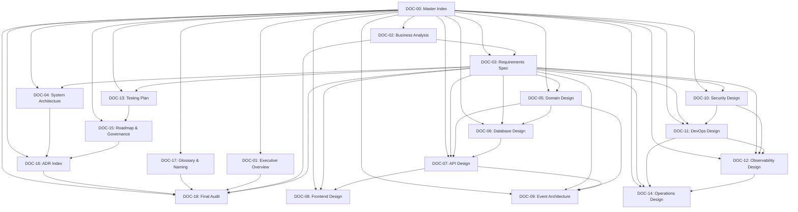

# ═══════════════════════════════════════════════════════════════
#  NEXUSASSET CLOUD — MASTER INDEX & DOCUMENTATION MAP
# ═══════════════════════════════════════════════════════════════
#  Document ID        : DOC-00
#  Version            : 1.0.0
#  Status             : Baseline (Target/Design — Proposed Reference Architecture)
#  Classification     : Internal — Architecture & Engineering
#  Owner              : Architecture Guild / Documentation Lead
#  Reviewers          : Principal Software Architect, Principal Documentation Architect,
#                       Senior Business Analyst, Senior Security Architect, Senior DevOps Architect
#  Approvers          : CTO / VP Engineering
#  Last Reviewed      : 2026-11-09
#  Next Review        : 2026-12-09
#  Change Log         : v1.0.0 (2026-11-09) — Initial baseline creation
#  Source Authority   : NexusAsset Cloud Project Charter, Architecture Governance
#  Canonical Repo     : nexusasset-cloud/
#  Domains            : app.nexusasset.cloud  |  api.nexusasset.cloud
#  Package Scope      : @nexusasset/*
#  Secret Prefix      : NXA_*
# ═══════════════════════════════════════════════════════════════

# NexusAsset Cloud — Master Index & Documentation Map
**Where Discovery Meets Enterprise**

> **Purpose** — Provide the authoritative navigation, structure, and cross-reference map for the complete NexusAsset Cloud analysis and design documentation package (DOC-00 through DOC-18). This document is the entry point for all stakeholders — executives, architects, engineers, auditors, and operators.

---

## Table of Contents
1. [Document Control](#1-document-control)
2. [Documentation Package Overview](#2-documentation-package-overview)
3. [Document Inventory & Status](#3-document-inventory--status)
4. [Stable Identifier Scheme](#4-stable-identifier-scheme)
5. [Cross-Document Traceability Framework](#5-cross-document-traceability-framework)
6. [Reading Guide by Audience](#6-reading-guide-by-audience)
7. [Diagram Index](#7-diagram-index)
8. [Table & Matrix Index](#8-table--matrix-index)
9. [Conventions & Notation](#9-conventions--notation)
10. [Governance & Maintenance](#10-governance--maintenance)
11. [Executive Summary](#11-executive-summary)
12. [Technical Summary](#12-technical-summary)
13. [Cross-Reference Index](#13-cross-reference-index)
14. [Appendices](#14-appendices)

---

## 1. Document Control

### 1.1 Metadata

| Field | Value |
|---|---|
| **Document ID** | DOC-00 |
| **Title** | Master Index & Documentation Map |
| **Version** | 1.0.0 |
| **Status** | Baseline — Proposed Reference Architecture |
| **Classification** | Internal — Architecture & Engineering |
| **Owner** | Architecture Guild / Documentation Lead |
| **Reviewers** | Principal Software Architect, Principal Documentation Architect, Senior Business Analyst, Senior Security Architect, Senior DevOps Architect |
| **Approvers** | CTO / VP Engineering |
| **Created** | 2026-11-09 |
| **Last Reviewed** | 2026-11-09 |
| **Next Review** | 2026-12-09 |

### 1.2 Change Log

| Version | Date | Author | Summary |
|---|---|---|---|
| 1.0.0 | 2026-11-09 | Architecture Guild | Initial baseline creation of complete documentation package |

### 1.3 Related Documents

| Document ID | Title | Relationship |
|---|---|---|
| DOC-01 | Executive Overview | Entry point for non-technical stakeholders |
| DOC-02 | Business Analysis | Business capabilities & use cases |
| DOC-03 | Requirements Specification | Functional & non-functional requirements |
| DOC-04 | System Architecture Design | High-level architecture & ADRs |
| DOC-05 | Domain & Bounded Context Design | Per-context domain models |
| DOC-06 | Database & Multi-Tenancy Design | Schema, RLS, migrations, DR |
| DOC-07 | API & Integration Design | OpenAPI, AsyncAPI, Lansweeper |
| DOC-08 | Frontend & Design System Design | Next.js, design tokens, components |
| DOC-09 | Event-Driven Architecture Design | Events, outbox, DLQ, versioning |
| DOC-10 | Security, Compliance & Threat Model | Threat model, controls, compliance |
| DOC-11 | DevOps, Infrastructure & CI/CD Design | Docker, Ansible, Jenkins, pipelines |
| DOC-12 | Observability, SLO/SLI & Incident Response | Metrics, logs, traces, alerting |
| DOC-13 | Testing & Quality Assurance Plan | Test strategy, quality gates |
| DOC-14 | Operations, Runbooks & Disaster Recovery | Runbooks, backup, DR |
| DOC-15 | Implementation Roadmap, Risks & Governance | Phased plan, risks, governance |
| DOC-16 | ADR Index & Decision Log | Architecture decision records |
| DOC-17 | Glossary, Naming Conventions & Reference Tables | Terminology & naming standards |
| DOC-18 | Final Audit Report & Consistency Matrix | Cross-package audit & scorecard |

### 1.4 Reference Baseline

All documents in this package derive from and must not contradict:
- **Project Charter**: NexusAsset Cloud — Enterprise Monorepo
- **Architecture Style**: Modular Monolith + DDD + Clean Architecture
- **Bounded Contexts**: Core, Accounts, Identity, Tenants, Organizations, Assets, Asset Lifecycle, Lansweeper, Integrations, Billing, Subscriptions, Notifications, Audit, Reporting, Compliance
- **Technology Baseline**: Python 3.13, Django 5.2 LTS, Next.js 16, React 19, PostgreSQL 18, Redis 8, Celery, RabbitMQ (optional), pnpm, Turborepo, OpenAPI 3.1, AsyncAPI, Kotlin, Swift, Docker, Docker Compose, Traefik v3, Jenkins LTS, Ansible, Prometheus, Grafana, Loki, OpenTelemetry, Tempo, Trivy, Gitleaks, SonarQube, SOPS, Pytest, Vitest, Playwright, k6, pgBackRest/WAL-G
- **Critical Requirements**: RLS defense-in-depth, OpenAPI 3.1 authoritative, Transactional Outbox, Lansweeper non-corruption, Frontend not security boundary, design-system/tokens/*.json authoritative, technology validation required

---

## 2. Documentation Package Overview

### 2.1 Purpose & Scope

This documentation package constitutes the **complete analysis and design specification** for NexusAsset Cloud v1.0.0. It covers:

┌─────────────────────────────────────────────────────────────────────┐
│ ▸ IN-SCOPE                                                           │
├─────────────────────────────────────────────────────────────────────┤
│ • Executive vision and business justification                       │
│ • Complete business capability model and use cases                  │
│ • Functional and non-functional requirements with traceability      │
│ • System architecture (C4 Levels 1–3, deployment, ADRs)             │
│ • Domain models for all 15 bounded contexts                         │
│ • Database design with RLS policies and multi-tenancy               │
│ • API contracts (OpenAPI 3.1) and event contracts (AsyncAPI)        │
│ • Frontend architecture and design system                           │
│ • Event-driven architecture (outbox, DLQ, versioning)               │
│ • Security threat model, compliance, controls                       │
│ • DevOps infrastructure and CI/CD pipelines                         │
│ • Observability, SLOs, incident response                            │
│ • Testing strategy and quality gates                                │
│ • Operations runbooks and disaster recovery                         │
│ • Implementation roadmap with risks and governance                  │
│ • Architecture decision records and glossary                        │
│ • Final audit and consistency matrix                                │
└─────────────────────────────────────────────────────────────────────┘

┌─────────────────────────────────────────────────────────────────────┐
│ ▸ OUT-OF-SCOPE                                                       │
├─────────────────────────────────────────────────────────────────────┤
│ • Lansweeper platform internals (external dependency)               │
│ • Detailed implementation code (separate repository)                │
│ • Infrastructure provisioning scripts (IaC repositories)            │
│ • Operational playbooks for specific cloud providers                │
│ • Legal contracts and commercial terms                              │
│ • Marketing materials and user-facing documentation                 │
└─────────────────────────────────────────────────────────────────────┘

### 2.2 Document Hierarchy & Dependencies



### 2.3 Document Maturity Levels

| Level | Description | Documents |
|---|---|---|
| **L0 — Baseline** | Proposed reference architecture; not yet validated by implementation | All (DOC-00 through DOC-18) |
| **L1 — Validated** | Architecture decisions confirmed by prototype/POC | Target for Phase 2 |
| **L2 — Production-Ready** | Implemented, tested, deployed in staging | Target for Phase 4 |
| **L3 — Certified** | Third-party audit complete (SOC 2, ISO 27001) | Target for Phase 6 |

---

## 3. Document Inventory & Status

| Doc ID | Title | Status | Version | Owner | Primary Audience | Est. Pages |
|---|---|---|---|---|---|---|
| **DOC-00** | Master Index & Documentation Map | ✅ Baseline | 1.0.0 | Architecture Guild | All | 15 |
| **DOC-01** | Executive Overview | ✅ Baseline | 1.0.0 | Product Leadership | Executives, Investors, Auditors | 20 |
| **DOC-02** | Business Analysis | ✅ Baseline | 1.0.0 | Business Analysis | Product, Architecture, Sales | 35 |
| **DOC-03** | Requirements Specification | ✅ Baseline | 1.0.0 | Requirements Engineering | All Engineering, QA, Security | 50 |
| **DOC-04** | System Architecture Design | ✅ Baseline | 1.0.0 | Architecture Guild | Architects, Tech Leads, DevOps | 45 |
| **DOC-05** | Domain & Bounded Context Design | ✅ Baseline | 1.0.0 | Domain Architects | Backend Engineers, Architects | 80 |
| **DOC-06** | Database & Multi-Tenancy Design | ✅ Baseline | 1.0.0 | Data Architecture | Backend Engineers, DBAs, Security | 40 |
| **DOC-07** | API & Integration Design | ✅ Baseline | 1.0.0 | API Guild | All Engineers, Frontend, Mobile | 45 |
| **DOC-08** | Frontend & Design System Design | ✅ Baseline | 1.0.0 | Frontend Architecture | Frontend Engineers, Designers | 35 |
| **DOC-09** | Event-Driven Architecture Design | ✅ Baseline | 1.0.0 | Platform Architecture | Backend Engineers, DevOps | 30 |
| **DOC-10** | Security, Compliance & Threat Model | ✅ Baseline | 1.0.0 | Security Architecture | Security, Compliance, Legal | 40 |
| **DOC-11** | DevOps, Infrastructure & CI/CD Design | ✅ Baseline | 1.0.0 | DevOps Architecture | DevOps, SRE, Platform Engineers | 35 |
| **DOC-12** | Observability, SLO/SLI & Incident Response | ✅ Baseline | 1.0.0 | SRE / Observability | SRE, Backend, Frontend | 30 |
| **DOC-13** | Testing & Quality Assurance Plan | ✅ Baseline | 1.0.0 | QA / Test Architecture | All Engineers, QA | 35 |
| **DOC-14** | Operations, Runbooks & Disaster Recovery | ✅ Baseline | 1.0.0 | SRE / Operations | SRE, Support, On-Call | 30 |
| **DOC-15** | Implementation Roadmap, Risks & Governance | ✅ Baseline | 1.0.0 | Program Management | Leadership, All Teams | 25 |
| **DOC-16** | ADR Index & Decision Log | ✅ Baseline | 1.0.0 | Architecture Guild | Architects, Tech Leads | 20 |
| **DOC-17** | Glossary, Naming Conventions & Reference Tables | ✅ Baseline | 1.0.0 | Documentation Lead | All | 15 |
| **DOC-18** | Final Audit Report & Consistency Matrix | ✅ Baseline | 1.0.0 | Architecture Guild | All | 25 |

**Total Estimated Pages**: ~650+

---

## 4. Stable Identifier Scheme

All artifacts across all documents use stable, human-readable identifiers per the scheme below. These IDs are **immutable** once assigned and must be used for all cross-references.

### 4.1 Identifier Categories

| Category | Prefix | Format | Example | Scope |
|---|---|---|---|---|
| **Requirements — Functional** | REQ-FN- | REQ-FN-NNN | REQ-FN-001 | Global |
| **Requirements — Non-Functional** | REQ-NFR- | REQ-NFR-NNN | REQ-NFR-001 | Global |
| **Business Capabilities** | CAP- | CAP-NNN | CAP-001 | Global |
| **Domain Entities** | ENT- | ENT-CTX-NNN | ENT-AST-001 | Per Context |
| **Aggregates** | AGG- | AGG-CTX-NNN | AGG-AST-001 | Per Context |
| **Value Objects** | VO- | VO-CTX-NNN | VO-AST-001 | Per Context |
| **Domain Events** | EVT- | EVT-CTX-NNN | EVT-AST-001 | Per Context |
| **Integration Events** | IEV- | IEV-CTX-NNN | IEV-LSW-001 | Per Context |
| **API Endpoints** | API- | API-CTX-NNN | API-AST-001 | Per Context |
| **Database Tables** | TBL- | TBL-CTX-NNN | TBL-AST-001 | Per Context |
| **RLS Policies** | RLS- | RLS-TBL-NNN | RLS-AST-001 | Per Table |
| **Architecture Decision Records** | ADR- | ADR-NNN | ADR-001 | Global |
| **Risks** | RSK- | RSK-NNN | RSK-001 | Global |
| **Assumptions** | ASM- | ASM-NNN | ASM-001 | Global |
| **Constraints** | CNS- | CNS-NNN | CNS-001 | Global |
| **Test Cases** | TC- | TC-TYPE-NNN | TC-UNIT-001 | Global |
| **Diagrams** | DIA- | DIA-NNN | DIA-001 | Global |
| **SLOs** | SLO- | SLO-NNN | SLO-001 | Global |
| **Runbooks** | RB- | RB-NNN | RB-001 | Global |
| **Bounded Context Codes** | — | 3-letter code | AST, LSW, TNT, etc. | Per Context |

### 4.2 Bounded Context Codes

| Code | Bounded Context | Description |
|---|---|---|
| **COR** | Core | Shared kernel, cross-cutting concerns |
| **ACC** | Accounts | User account management |
| **IDT** | Identity | Authentication & authorization core |
| **TNT** | Tenants | Multi-tenancy & hierarchy |
| **ORG** | Organizations | Organizational structure |
| **AST** | Assets | CMDB & asset management |
| **ALC** | Asset Lifecycle | Advanced lifecycle & ownership |
| **LSW** | Lansweeper | Discovery integration & sync |
| **INT** | Integrations | Generic integration framework |
| **BIL** | Billing | Financial transactions & invoicing |
| **SUB** | Subscriptions | Plans & entitlements |
| **NOT** | Notifications | Multi-channel delivery |
| **AUD** | Audit | Immutable audit trail |
| **REP** | Reporting | Analytics & exports |
| **CPL** | Compliance | Policy & attestation |

---

## 5. Cross-Document Traceability Framework

### 5.1 Traceability Requirements

Every artifact must maintain **bidirectional traceability** across the following dimensions:

┌─────────────────────────────────────────────────────────────────────┐
│ ▸ MANDATORY TRACEABILITY LINKS                                       │
├─────────────────────────────────────────────────────────────────────┤
│ 1. Requirement ↔ Business Capability (DOC-02)                       │
│ 2. Requirement ↔ Architecture Decision (DOC-04 / DOC-16)            │
│ 3. Requirement ↔ Domain Element (DOC-05)                            │
│ 4. Requirement ↔ Database Object (DOC-06)                           │
│ 5. Requirement ↔ API/Event Contract (DOC-07)                        │
│ 6. Requirement ↔ Frontend Feature (DOC-08)                          │
│ 7. Requirement ↔ Security Control (DOC-10)                          │
│ 8. Requirement ↔ Test Case (DOC-13)                                 │
│ 9. Requirement ↔ Deployment Component (DOC-11)                      │
│ 10. Database Table ↔ Domain Aggregate & Context                     │
│ 11. Database Table ↔ RLS Policy                                     │
│ 12. Database Table ↔ Migration File                                 │
│ 13. Database Table ↔ Backup/Restore Procedure                       │
│ 14. Database Table ↔ Tenant Isolation Test Case                     │
│ 15. API Endpoint ↔ OpenAPI Path                                     │
│ 16. API Endpoint ↔ Domain Service                                   │
│ 17. API Endpoint ↔ Test Case                                        │
│ 18. API Endpoint ↔ Security Control                                 │
│ 19. API Endpoint ↔ Rate-Limit Policy                                │
│ 20. Event ↔ AsyncAPI Channel                                        │
│ 21. Event ↔ Producer Context                                        │
│ 22. Event ↔ Consumer Context                                        │
│ 23. Event ↔ Outbox Table                                            │
│ 24. Event ↔ Idempotency Key                                         │
│ 25. Event ↔ DLQ Policy                                              │
└─────────────────────────────────────────────────────────────────────┘

### 5.2 Traceability Matrix Template

Each document must include a traceability matrix section using this format:

| Source Artifact | Source ID | Target Artifact | Target ID | Link Type | Status |
|---|---|---|---|---|---|
| REQ-FN-001 | Create Tenant | Business Capability | CAP-003 | Implements | ✅ Traced |
| REQ-FN-001 | Create Tenant | ADR | ADR-008 | Decided By | ✅ Traced |
| REQ-FN-001 | Create Tenant | Domain Entity | ENT-TNT-001 | Realized By | ✅ Traced |
| REQ-FN-001 | Create Tenant | Database Table | TBL-TNT-001 | Persisted In | ✅ Traced |
| REQ-FN-001 | Create Tenant | API Endpoint | API-TNT-001 | Exposed Via | ✅ Traced |
| REQ-FN-001 | Create Tenant | Test Case | TC-INT-001 | Verified By | ✅ Traced |

### 5.3 Traceability Tooling

| Tool | Purpose | Integration |
|---|---|---|
| **Requirements Repository** | Central requirement store | Git-based (Markdown + YAML front-matter) |
| **Traceability Validator** | CI gate for missing links | Custom script in `platform/scripts/validate-traceability.sh` |
| **Documentation Generator** | Auto-generate matrices | `platform/scripts/generate-traceability-matrix.py` |
| **ADR Tracker** | Decision log with links | `docs/12-adr/` with front-matter linking |

---

## 6. Reading Guide by Audience

### 6.1 Executive Leadership (CEO, CTO, VP Engineering, Investors)

| Priority | Documents | Focus Areas |
|---|---|---|
| **1** | DOC-01 | Vision, value prop, success criteria, investment |
| **2** | DOC-15 | Roadmap, phases, risks, resource requirements |
| **3** | DOC-18 | Audit scorecard, readiness assessment |
| **Reference** | DOC-00, DOC-17 | Navigation, terminology |

### 6.2 Product Management & Business Analysis

| Priority | Documents | Focus Areas |
|---|---|---|
| **1** | DOC-02 | Capabilities, processes, use cases, KPIs |
| **2** | DOC-03 | Requirements, acceptance criteria |
| **3** | DOC-05 | Domain models, business rules |
| **4** | DOC-07 | API contracts, integration specs |
| **Reference** | DOC-17, DOC-16 | Glossary, ADRs |

### 6.3 Software Architects & Tech Leads

| Priority | Documents | Focus Areas |
|---|---|---|
| **1** | DOC-04 | C4 architecture, ADRs, deployment model |
| **2** | DOC-05 | Bounded contexts, aggregates, events |
| **3** | DOC-06 | Data models, RLS, migrations |
| **4** | DOC-07 | OpenAPI, AsyncAPI, versioning |
| **4** | DOC-09 | Event architecture, outbox, DLQ |
| **5** | DOC-10 | Threat model, security controls |
| **5** | DOC-16 | ADR index, decision rationale |
| **Reference** | DOC-00, DOC-17, DOC-18 | Index, glossary, audit |

### 6.4 Backend Engineers (Python/Django)

| Priority | Documents | Focus Areas |
|---|---|---|
| **1** | DOC-05 | Domain models, application services, repositories |
| **2** | DOC-06 | ORM models, migrations, RLS policies |
| **3** | DOC-07 | DRF views, serializers, OpenAPI alignment |
| **4** | DOC-09 | Domain events, outbox, Celery tasks |
| **5** | DOC-10 | Authorization, secrets, encryption |
| **6** | DOC-13 | Unit/integration test patterns, architecture tests |
| **Reference** | DOC-04, DOC-16, DOC-17 | Architecture, ADRs, naming |

### 6.5 Frontend Engineers (TypeScript/Next.js/React)

| Priority | Documents | Focus Areas |
|---|---|---|
| **1** | DOC-08 | App Router structure, features, components |
| **2** | DOC-07 | API client generation, error handling |
| **3** | DOC-08 | Design tokens, theming, accessibility |
| **4** | DOC-10 | Client-side security, CSP, token handling |
| **5** | DOC-13 | Component testing, E2E, visual regression |
| **Reference** | DOC-04, DOC-17 | Architecture, naming |

### 6.6 Mobile Engineers (Kotlin/Swift)

| Priority | Documents | Focus Areas |
|---|---|---|
| **1** | DOC-07 | OpenAPI client generation, authentication |
| **2** | DOC-09 | Event consumption, offline sync |
| **3** | DOC-08 | Design tokens (shared), theming |
| **4** | DOC-10 | Certificate pinning, secure storage |
| **5** | DOC-13 | Unit/UI testing, contract testing |
| **Reference** | DOC-04, DOC-17 | Architecture, naming |

### 6.7 DevOps / Platform Engineers / SRE

| Priority | Documents | Focus Areas |
|---|---|---|
| **1** | DOC-11 | Docker, Compose, Ansible, Jenkins, pipelines |
| **2** | DOC-12 | Prometheus, Grafana, Loki, Tempo, OTel, SLOs |
| **3** | DOC-14 | Runbooks, backup/restore, DR procedures |
| **4** | DOC-04 | Deployment topology, network, containers |
| **5** | DOC-10 | Supply chain, image signing, secrets |
| **6** | DOC-13 | Quality gates, performance budgets |
| **Reference** | DOC-11, DOC-16, DOC-17 | Infrastructure, ADRs, naming |

### 6.8 Security & Compliance

| Priority | Documents | Focus Areas |
|---|---|---|
| **1** | DOC-10 | Threat model, controls matrix, compliance mapping |
| **2** | DOC-06 | RLS policies, encryption, data classification |
| **3** | DOC-07 | AuthN/AuthZ, rate limiting, webhook security |
| **4** | DOC-11 | Supply chain, SBOM, image signing, scanning |
| **5** | DOC-12 | Audit logging, alerting on security events |
| **6** | DOC-14 | Incident response, forensic readiness |
| **Reference** | DOC-10, DOC-16, DOC-17 | Controls, ADRs, glossary |

### 6.9 QA / Test Engineers

| Priority | Documents | Focus Areas |
|---|---|---|
| **1** | DOC-13 | Test pyramid, quality gates, coverage targets |
| **2** | DOC-03 | Requirements → test case mapping |
| **3** | DOC-05 | Domain test scenarios, edge cases |
| **4** | DOC-07 | Contract testing, API test patterns |
| **5** | DOC-09 | Event testing, idempotency, DLQ |
| **6** | DOC-10 | Security testing, penetration testing |
| **Reference** | DOC-13, DOC-17 | Quality plan, glossary |

### 6.10 Auditors (Internal & External)

| Priority | Documents | Focus Areas |
|---|---|---|
| **1** | DOC-01 | Executive overview, compliance posture |
| **2** | DOC-10 | Threat model, controls, compliance evidence |
| **3** | DOC-06 | Data protection, RLS, encryption |
| **4** | DOC-12 | Observability, audit logging, SLOs |
| **5** | DOC-14 | Incident response, backup, DR |
| **6** | DOC-18 | Audit report, consistency, gaps |
| **Reference** | DOC-17 | Terminology |

---

## 7. Diagram Index

All diagrams across the documentation package are cataloged here with stable IDs. Each diagram is defined in Mermaid or PlantUML format and embedded in its owning document.

### 7.1 Structural Diagrams (C4 & Code)

| Diagram ID | Title | Type | Owner Document | Context |
|---|---|---|---|---|
| DIA-001 | System Context (C4 Level 1) | C4 Context | DOC-01, DOC-04 | Executive & Architecture |
| DIA-002 | Container Topology (C4 Level 2) | C4 Container | DOC-04 | Architecture |
| DIA-003 | Component Diagram — nxa_backend (C4 Level 3) | C4 Component | DOC-04, DOC-05 | Backend Architecture |
| DIA-004 | Component Diagram — nxa_frontend (C4 Level 3) | C4 Component | DOC-04, DOC-08 | Frontend Architecture |
| DIA-005 | Component Diagram — nxa_worker (C4 Level 3) | C4 Component | DOC-04, DOC-09 | Worker Architecture |
| DIA-006 | Monorepo Folder Structure | Package Diagram | DOC-00, DOC-04 | Repository Structure |
| DIA-007 | Module Dependency Graph | Dependency Graph | DOC-04, DOC-05 | Clean Architecture |
| DIA-008 | Bounded Context Map | Context Map | DOC-02, DOC-04, DOC-05 | DDD |
| DIA-009 | Class Diagram — Asset Aggregate | Class Diagram | DOC-05, DOC-06 | Domain Model |
| DIA-010 | Class Diagram — Tenant Aggregate | Class Diagram | DOC-05, DOC-06 | Domain Model |
| DIA-011 | Class Diagram — Lansweeper Sync Aggregate | Class Diagram | DOC-05, DOC-06 | Domain Model |
| DIA-012 | Class Diagram — Subscription Aggregate | Class Diagram | DOC-05, DOC-06 | Domain Model |
| DIA-013 | Package Diagram — nxa_lansweeper | Package Diagram | DOC-05 | Context Structure |
| DIA-014 | Package Diagram — nxa_assets | Package Diagram | DOC-05 | Context Structure |
| DIA-015 | Package Diagram — nxa_tenants | Package Diagram | DOC-05 | Context Structure |

### 7.2 Behavioral Diagrams

| Diagram ID | Title | Type | Owner Document | Context |
|---|---|---|---|---|
| DIA-016 | Use Case Diagram — Platform Overview | Use Case | DOC-02 | Business Analysis |
| DIA-017 | Use Case Diagram — nxa_lansweeper | Use Case | DOC-02, DOC-05 | Integration Context |
| DIA-018 | Use Case Diagram — nxa_tenants | Use Case | DOC-02, DOC-05 | Tenancy Context |
| DIA-019 | Activity Diagram — Asset Discovery Sync | Activity | DOC-02, DOC-05, DOC-09 | Core Process |
| DIA-020 | Activity Diagram — Tenant Onboarding | Activity | DOC-02, DOC-05 | Core Process |
| DIA-021 | Activity Diagram — Billing Cycle | Activity | DOC-02, DOC-05 | Core Process |
| DIA-022 | Sequence Diagram — User Authentication | Sequence | DOC-04, DOC-07, DOC-10 | Auth Flow |
| DIA-023 | Sequence Diagram — Asset Query (BFF → Backend) | Sequence | DOC-04, DOC-07, DOC-08 | API Flow |
| DIA-024 | Sequence Diagram — Lansweeper Delta Sync | Sequence | DOC-04, DOC-07, DOC-09 | Integration Flow |
| DIA-025 | Sequence Diagram — Lansweeper Webhook Processing | Sequence | DOC-04, DOC-07, DOC-09 | Integration Flow |
| DIA-026 | Sequence Diagram — Event Publishing (Outbox) | Sequence | DOC-09 | Event Flow |
| DIA-027 | Sequence Diagram — Event Consumption & DLQ | Sequence | DOC-09 | Event Flow |
| DIA-028 | State Machine — Asset Lifecycle | State Machine | DOC-05, DOC-06 | Domain Model |
| DIA-029 | State Machine — Subscription Lifecycle | State Machine | DOC-05, DOC-06 | Domain Model |
| DIA-030 | State Machine — Tenant Lifecycle | State Machine | DOC-05, DOC-06 | Domain Model |
| DIA-031 | State Machine — Sync Job State | State Machine | DOC-05, DOC-09 | Integration |
| DIA-032 | BPMN — Asset Discovery to Governance | Flowchart/BPMN | DOC-02 | Business Process |

### 7.3 Data Diagrams

| Diagram ID | Title | Type | Owner Document | Context |
|---|---|---|---|---|
| DIA-033 | Conceptual ER Diagram | ER Diagram | DOC-06 | Data Model |
| DIA-034 | Logical ER Diagram — Assets & Tenants | ER Diagram | DOC-06 | Data Model |
| DIA-035 | Logical ER Diagram — Lansweeper Sync | ER Diagram | DOC-06 | Data Model |
| DIA-036 | Logical ER Diagram — Billing & Subscriptions | ER Diagram | DOC-06 | Data Model |
| DIA-037 | Physical ER Diagram — nxa_assets | ER Diagram | DOC-06 | Data Model |
| DIA-038 | Physical ER Diagram — nxa_tenants | ER Diagram | DOC-06 | Data Model |
| DIA-039 | Physical ER Diagram — nxa_lansweeper | ER Diagram | DOC-06 | Data Model |
| DIA-040 | Data Flow Diagram — Context Level (Level 0) | DFD | DOC-04, DOC-06 | Data Architecture |
| DIA-041 | Data Flow Diagram — Level 1 (Bounded Contexts) | DFD | DOC-04, DOC-06 | Data Architecture |
| DIA-042 | Tenant Isolation — Logical View | Isolation Diagram | DOC-06, DOC-10 | Multi-Tenancy |
| DIA-043 | Tenant Isolation — Physical View (RLS) | Isolation Diagram | DOC-06, DOC-10 | Multi-Tenancy |
| DIA-044 | RLS Policy Flow Diagram | Flow Diagram | DOC-06, DOC-10 | Security |
| DIA-045 | Data Lifecycle — Ingestion to Archival | Lifecycle Diagram | DOC-06 | Data Architecture |

### 7.4 Integration Diagrams

| Diagram ID | Title | Type | Owner Document | Context |
|---|---|---|---|---|
| DIA-046 | System Integration — Lansweeper & External | Integration Diagram | DOC-04, DOC-07 | Integration |
| DIA-047 | API Interaction — REST & BFF | Interaction Diagram | DOC-07, DOC-08 | API |
| DIA-048 | Event Flow — Domain & Integration Events | Event Flow | DOC-09 | Events |
| DIA-049 | Transactional Outbox Pattern | Pattern Diagram | DOC-09 | Events |
| DIA-050 | Webhook Processing — Lansweeper | Flow Diagram | DOC-07, DOC-09 | Integration |
| DIA-051 | Retry/Backoff & DLQ Flow | Flow Diagram | DOC-09 | Events |
| DIA-052 | Rate Limiting Tiers | Tier Diagram | DOC-07, DOC-10 | API Security |

### 7.5 Security Diagrams

| Diagram ID | Title | Type | Owner Document | Context |
|---|---|---|---|---|
| DIA-053 | Threat Model — STRIDE Overview | STRIDE | DOC-10 | Security |
| DIA-054 | Threat Model — Data Flow with Trust Boundaries | DFD + Trust | DOC-10 | Security |
| DIA-055 | Identity & Access Flow — AuthN/AuthZ | Flow Diagram | DOC-10 | Security |
| DIA-056 | Secret Management Flow | Flow Diagram | DOC-10, DOC-11 | Security |
| DIA-057 | Supply Chain Pipeline — SLSA | Pipeline Diagram | DOC-10, DOC-11 | Security |
| DIA-058 | Incident Response Flow | Flow Diagram | DOC-10, DOC-14 | Security |

### 7.6 Operational Diagrams

| Diagram ID | Title | Type | Owner Document | Context |
|---|---|---|---|---|
| DIA-059 | Deployment Topology — Development | Deployment | DOC-11 | DevOps |
| DIA-060 | Deployment Topology — Staging | Deployment | DOC-11 | DevOps |
| DIA-061 | Deployment Topology — Production | Deployment | DOC-11 | DevOps |
| DIA-062 | Network Topology — Production | Network | DOC-11 | DevOps |
| DIA-063 | CI/CD Pipeline — Jenkins | Pipeline | DOC-11 | DevOps |
| DIA-064 | CI/CD Pipeline — GitHub Actions | Pipeline | DOC-11 | DevOps |
| DIA-065 | Observability Data Flow | Data Flow | DOC-12 | Observability |
| DIA-066 | Backup & Restore Flow | Flow Diagram | DOC-14 | Operations |
| DIA-067 | Disaster Recovery Switchover | Flow Diagram | DOC-14 | Operations |
| DIA-068 | SLO/SLI Calculation Diagram | Calculation | DOC-12 | Observability |

### 7.7 Planning Diagrams

| Diagram ID | Title | Type | Owner Document | Context |
|---|---|---|---|---|
| DIA-069 | Implementation Roadmap — Gantt | Gantt Chart | DOC-15 | Roadmap |
| DIA-070 | Phase Dependency Graph | Dependency | DOC-15 | Roadmap |
| DIA-071 | Risk Heat Map | Table/Matrix | DOC-15, DOC-18 | Risk |
| DIA-072 | RACI Matrix — Key Roles | Table | DOC-15, DOC-18 | Governance |
| DIA-073 | Stakeholder Map | Stakeholder | DOC-02, DOC-18 | Governance |

**Total Diagrams**: 73

---

## 8. Table & Matrix Index

Key tables and matrices across all documents:

| Matrix ID | Title | Owner Document | Purpose |
|---|---|---|---|
| MTX-001 | Capability Maturity Model | DOC-02 | Business maturity assessment |
| MTX-002 | Stakeholder Value Mapping | DOC-02 | Value per stakeholder |
| MTX-003 | Use Case Registry (All Contexts) | DOC-02, DOC-05 | Complete use case index |
| MTX-004 | Requirements Traceability Matrix | DOC-03, DOC-18 | Full bidirectional traceability |
| MTX-005 | NFR Classification Matrix | DOC-03 | Non-functional categorization |
| MTX-006 | ADR Register | DOC-04, DOC-16 | Architecture decisions |
| MTX-007 | Bounded Context Responsibilities | DOC-05 | Context boundaries |
| MTX-008 | Aggregate Inventory | DOC-05, DOC-06 | Domain aggregates |
| MTX-009 | Domain Event Catalog | DOC-05, DOC-09 | Events |
| MTX-010 | Integration Event Catalog | DOC-07, DOC-09 | AsyncAPI events |
| MTX-011 | Database Table Inventory | DOC-06 | All tables with RLS |
| MTX-012 | RLS Policy Registry | DOC-06, DOC-10 | All policies |
| MTX-013 | API Endpoint Registry | DOC-07 | OpenAPI paths |
| MTX-014 | API Versioning Matrix | DOC-07 | Versions & deprecation |
| MTX-015 | Security Controls Matrix | DOC-10 | Controls vs. threats |
| MTX-016 | Compliance Mapping Matrix | DOC-10 | Regulations vs. controls |
| MTX-017 | Threat Register (STRIDE) | DOC-10 | Identified threats |
| MTX-018 | CI/CD Quality Gate Matrix | DOC-11, DOC-13 | Pipeline gates |
| MTX-019 | SLO/SLI Definitions | DOC-12 | Service level objectives |
| MTX-020 | Alert Rule Registry | DOC-12 | Prometheus alerts |
| MTX-021 | Runbook Registry | DOC-14 | Operational procedures |
| MTX-022 | Test Case Registry | DOC-13 | All test cases |
| MTX-023 | Test Coverage Targets | DOC-13 | Coverage by layer |
| MTX-024 | Risk Register | DOC-15, DOC-18 | Identified risks |
| MTX-025 | Assumption Register | DOC-18 | Validated assumptions |
| MTX-026 | Glossary Master | DOC-17 | Terminology |
| MTX-027 | Naming Convention Reference | DOC-17 | Canonical names |
| MTX-028 | Audit Scorecard | DOC-18 | Document quality scores |

---

## 9. Conventions & Notation

### 9.1 RFC 2119 Keywords

| Keyword | Meaning | Usage |
|---|---|---|
| **MUST** | Absolute requirement | Architecture rules, security controls |
| **MUST NOT** | Absolute prohibition | Forbidden patterns, anti-patterns |
| **SHOULD** | Strong recommendation | Best practices, preferred approaches |
| **SHOULD NOT** | Strong discouragement | Discouraged patterns |
| **MAY** | Optional | Alternatives, extensions |

### 9.2 Callout Styles

| Style | Marker | Purpose |
|---|---|---|
| **Note** | `> **Note** —` | Supplementary information |
| **Warning** | `> ⚠ **Warning** —` | Critical caveat or danger |
| **Decision** | `> ✅ **Decision** —` | Architectural decision made |
| **Assumption** | `> 📋 **Assumption (ASM-###)** —` | Explicit assumption requiring validation |
| **Risk** | `> 🔴 **Risk (RSK-###)** —` | Identified risk with mitigation |
| **Inferred** | `> 🔍 **Inferred** —` | Detail not in baseline, derived by analysis |
| **Requires Validation** | `> ✅ **Requires Validation** —` | Must be confirmed before implementation |

### 9.3 Diagram Conventions

| Convention | Rule |
|---|---|
| **Mermaid** | Default format; use `mermaid` code fences |
| **PlantUML** | Use when Mermaid lacks semantics; use `plantuml` code fences |
| **Diagram ID** | Every diagram has `DIA-###` in title comment |
| **Legend** | Required for diagrams with >5 element types |
| **Cross-refs** | Diagram caption includes "See DOC-XX §Y.Z" |
| **Colors** | Consistent palette: Blue=System, Green=Success, Yellow=Warning, Red=Critical, Purple=External |

### 9.4 Table Conventions

| Convention | Rule |
|---|---|
| **Headers** | Bold, sentence case |
| **Alignment** | Left for text, right for numbers, center for status |
| **Status Icons** | ✅ Complete, 🟡 In Progress, 🔴 Blocked, ⚪ Not Started, ❓ Unknown |
| **IDs** | First column where applicable |

---

## 10. Governance & Maintenance

### 10.1 Document Lifecycle

| Phase | Trigger | Action | Owner |
|---|---|---|---|
| **Draft** | New document created | Write content, assign IDs | Author |
| **Review** | Author completes draft | Peer review (2+ reviewers) | Reviewers |
| **Approved** | Reviewers sign off | Merge to main, version bump | Approver |
| **Baseline** | Architecture milestone | Tag release, distribute | Architecture Guild |
| **Validated** | POC/implementation confirms | Update status to "Validated" | Tech Lead |
| **Production-Ready** | Deployed to staging | Update status, link evidence | SRE/Release |
| **Certified** | Third-party audit | Update status, attach report | Security/Compliance |
| **Archived** | Superseded by new version | Move to archive, redirect | Documentation Lead |

### 10.2 Versioning Policy

| Change Type | Version Increment | Example |
|---|---|---|
| **Major** | Breaking changes to architecture/contracts | 1.0.0 → 2.0.0 |
| **Minor** | New sections, non-breaking additions | 1.0.0 → 1.1.0 |
| **Patch** | Corrections, clarifications, formatting | 1.0.0 → 1.0.1 |

### 10.3 Review Cadence

| Document Tier | Review Frequency | Trigger Reviews |
|---|---|---|
| **Architecture (DOC-04, DOC-05, DOC-06, DOC-07, DOC-09, DOC-10, DOC-16)** | Quarterly | Any ADR, major requirement change |
| **Design (DOC-08, DOC-11, DOC-12, DOC-14)** | Semi-annually | Technology version upgrades |
| **Planning (DOC-15, DOC-18)** | Per release | Milestone completion |
| **Reference (DOC-00, DOC-17)** | As needed | New documents added |
| **Business (DOC-01, DOC-02, DOC-03)** | Annually | Strategy changes |

---

## 11. Executive Summary

> **NexusAsset Cloud** is an **open-source, multi-tenant enterprise platform** that unifies **Lansweeper IT asset discovery** with **governance-grade CMDB, ITAM, billing, audit, compliance, and operations** in a single, secure, observable platform.
>
> **This documentation package (DOC-00 through DOC-18)** provides the **complete analysis and design specification** for the v1.0.0 Proposed Reference Architecture. It contains **19 documents**, **73 diagrams**, **28 major matrices**, and **650+ estimated pages** of exhaustive, cross-linked, professionally formatted content.
>
> **Architecture**: Modular Monolith (Django 5.2 LTS + DRF) with Clean Architecture, 15 DDD bounded contexts (`nxa_*`), OpenAPI 3.1 contract-first REST, AsyncAPI event contracts, PostgreSQL 18 with mandatory Row-Level Security (RLS) as defense-in-depth.
>
> **Key Differentiators**: Idempotent Lansweeper sync with Field Ownership Matrix, Transactional Outbox for event reliability, BFF pattern for web, generated clients for mobile, full IaC (Docker/Compose/Ansible/Jenkins), enterprise observability (Prometheus/Grafana/Loki/Tempo/OTel), security-by-default (Trivy/Gitleaks/SonarQube/SOPS/SLSA).
>
> **Status**: **Baseline — Proposed Reference Architecture**. All documents at L0 maturity. Next phase: prototype validation (L1) via phased implementation roadmap (DOC-15).
>
> **Investment**: 6-9 months to MVP (Phases 1-8), 12-18 months to production-hardened (Phases 9-14). Team: 4-6 backend, 2-3 frontend, 1-2 mobile, 1-2 DevOps/SRE, 1 security, 1 technical writer.
>
> **Risk Profile**: Medium-High (RLS at scale, Lansweeper API dependency, Clean Architecture discipline). Mitigated by phased verification, contract tests, chaos engineering, architecture governance.
>
> **Next Step**: Architecture review → Approve baseline → Execute Phase 1 (Foundation & Tooling).

---

## 12. Technical Summary

| Dimension | Summary |
|---|---|
| **Architecture Style** | Modular Monolith + DDD + Clean Architecture |
| **Bounded Contexts** | 15 (`nxa_core`, `nxa_accounts`, `nxa_identity`, `nxa_tenants`, `nxa_organizations`, `nxa_assets`, `nxa_asset_lifecycle`, `nxa_lansweeper`, `nxa_integrations`, `nxa_billing`, `nxa_subscriptions`, `nxa_notifications`, `nxa_audit`, `nxa_reporting`, `nxa_compliance`) |
| **API Contract** | OpenAPI 3.1 (authoritative), AsyncAPI (events), codegen for TS/Kotlin/Swift |
| **Data Layer** | PostgreSQL 18 + RLS (FORCE ROW LEVEL SECURITY), Redis 8 (cache/broker) |
| **Async Processing** | Celery + Redis (primary), RabbitMQ (optional for advanced routing) |
| **Event Pattern** | Transactional Outbox, idempotent consumers, DLQ, event versioning |
| **Frontend** | Next.js 16 App Router, React 19, TypeScript, Tailwind 4, shadcn/ui |
| **Design System** | `design-system/tokens/*.json` authoritative, generated CSS variables & TS tokens |
| **Mobile** | Android (Kotlin + Jetpack Compose), iOS (Swift + SwiftUI) |
| **Infrastructure** | Docker, Docker Compose, Traefik v3 (edge + TLS), Ansible |
| **CI/CD** | Jenkins LTS (primary), GitHub Actions (PR checks), quality gates |
| **Observability** | Prometheus, Grafana, Loki, Tempo, OpenTelemetry, SLO-based alerting |
| **Security** | Trivy (containers), Gitleaks (secrets), SonarQube (code), SOPS (secrets), SLSA L3 |
| **Testing** | Pytest (backend), Vitest (frontend), Playwright (E2E), k6 (load), contract tests |
| **Multi-Tenancy** | Application middleware + PostgreSQL RLS + restricted roles + negative tests |
| **Lansweeper Integration** | GraphQL, webhooks, delta, bulk; Field Ownership Matrix; idempotent upsert |
| **Compliance Targets** | SOC 2 Type II, ISO 27001, GDPR, PCI DSS (billing scope) |

---

## 13. Cross-Reference Index

### 13.1 Document-to-Document References

| From Document | To Document | Reference Purpose |
|---|---|---|
| DOC-00 | All | Master navigation |
| DOC-01 | DOC-02, DOC-03, DOC-04, DOC-15, DOC-18 | Vision → detail |
| DOC-02 | DOC-03, DOC-05, DOC-07, DOC-15 | Business → requirements, domain, API, roadmap |
| DOC-03 | DOC-04, DOC-05, DOC-06, DOC-07, DOC-08, DOC-09, DOC-10, DOC-11, DOC-12, DOC-13, DOC-14 | Requirements → all designs |
| DOC-04 | DOC-05, DOC-06, DOC-07, DOC-09, DOC-10, DOC-11, DOC-16 | Architecture → detailed designs, ADRs |
| DOC-05 | DOC-06, DOC-07, DOC-09 | Domain → data, API, events |
| DOC-06 | DOC-07, DOC-10 | Data → API, security |
| DOC-07 | DOC-08, DOC-09 | API → frontend, events |
| DOC-08 | DOC-10, DOC-13 | Frontend → security, testing |
| DOC-09 | DOC-10, DOC-13 | Events → security, testing |
| DOC-10 | DOC-11, DOC-12, DOC-14 | Security → DevOps, observability, ops |
| DOC-11 | DOC-12, DOC-14 | DevOps → observability, ops |
| DOC-12 | DOC-14 | Observability → ops |
| DOC-13 | DOC-15 | Testing → roadmap |
| DOC-15 | DOC-16 | Roadmap → ADRs |
| DOC-16 | DOC-18 | ADRs → audit |
| DOC-17 | All | Glossary reference |
| DOC-18 | All | Audit references all |

### 13.2 Key Cross-References by Artifact Type

| Artifact | Defined In | Referenced In |
|---|---|---|
| **REQ-FN-001** (Create Tenant) | DOC-03 | DOC-02, DOC-04, DOC-05, DOC-06, DOC-07, DOC-13 |
| **ENT-TNT-001** (Tenant) | DOC-05 | DOC-03, DOC-06, DOC-07, DOC-09 |
| **AGG-TNT-001** (Tenant Aggregate) | DOC-05 | DOC-06, DOC-09 |
| **EVT-TNT-001** (TenantCreated) | DOC-05 | DOC-09, DOC-07 |
| **IEV-LSW-001** (AssetDiscovered) | DOC-07 | DOC-05, DOC-09 |
| **API-TNT-001** (POST /tenants) | DOC-07 | DOC-03, DOC-05, DOC-08, DOC-13 |
| **TBL-TNT-001** (tenants) | DOC-06 | DOC-03, DOC-05, DOC-10, DOC-13 |
| **RLS-TNT-001** (tenant_isolation) | DOC-06 | DOC-06, DOC-10, DOC-13 |
| **ADR-008** (Multi-Tenancy Strategy) | DOC-16 | DOC-04, DOC-06, DOC-10 |
| **RSK-003** (RLS Performance at Scale) | DOC-15 | DOC-06, DOC-18 |
| **ASM-007** (PostgreSQL 18 Compatibility) | DOC-18 | DOC-06, DOC-11 |
| **TC-INT-001** (Tenant Isolation Test) | DOC-13 | DOC-03, DOC-06, DOC-10 |
| **DIA-001** (System Context) | DOC-04 | DOC-00, DOC-01, DOC-02 |
| **SLO-001** (API Latency P95) | DOC-12 | DOC-07, DOC-11, DOC-13 |
| **RB-001** (Tenant Provisioning Runbook) | DOC-14 | DOC-11, DOC-12 |

---

## 14. Appendices

### Appendix A — Document Template (Per Section 5)

Every document in this package follows this structure:

```
1. Document Control (ID, Version, Status, Owner, Reviewers, Approvers, Change Log, Related Docs, Reference Baseline)
2. Table of Contents (auto-numbered, deep)
3. Executive Summary (1-2 pages)
4. Technical Summary (1-2 pages)
5. Scope and Out of Scope
6. Stakeholders and Audience
7. Conventions and Notation (naming, IDs, diagram legend)
8. Main Body (multi-level numbered sections §1, §1.1, §1.1.1)
9. Diagrams Section (or embedded throughout, with index)
10. Tables and Matrices Section
11. Assumptions, Constraints, and Open Questions
12. Risks and Mitigations
13. Cross-Reference Index
14. Traceability Index
15. Acceptance Criteria
16. Appendices
```

### Appendix B — Repository Paths for Documentation

| Document | Repository Path |
|---|---|
| DOC-00 | `docs/00-overview/00-master-index.md` |
| DOC-01 | `docs/00-overview/01-vision.md` |
| DOC-02 | `docs/01-analysis/02-business-analysis.md` |
| DOC-03 | `docs/01-analysis/03-requirements-specification.md` |
| DOC-04 | `docs/02-design/01-system-architecture.md` |
| DOC-05 | `docs/04-domain-design/01-bounded-contexts.md` |
| DOC-06 | `docs/11-database/01-database-multitenancy-design.md` |
| DOC-07 | `docs/09-api/01-api-integration-design.md` |
| DOC-08 | `docs/10-design-system/01-frontend-design-system.md` |
| DOC-09 | `docs/02-design/02-event-driven-architecture.md` |
| DOC-10 | `docs/07-security/01-security-compliance-threat-model.md` |
| DOC-11 | `docs/05-deployment/01-devops-infrastructure-cicd.md` |
| DOC-12 | `docs/14-observability/01-observability-slo-incident.md` |
| DOC-13 | `docs/04-testing/01-testing-quality-plan.md` |
| DOC-14 | `docs/06-operations/01-operations-runbooks-dr.md` |
| DOC-15 | `docs/03-implementation/01-implementation-roadmap.md` |
| DOC-16 | `docs/12-adr/00-adr-index.md` |
| DOC-17 | `docs/00-overview/03-glossary.md` |
| DOC-18 | `docs/14-appendices/01-final-audit-report.md` |

### Appendix C — Quality Checklist (Per Document)

| Check | Criteria |
|---|---|
| **Structure** | All 16 sections present and numbered |
| **Executive Summary** | 1-2 pages, non-technical audience |
| **Technical Summary** | 1-2 pages, engineering audience |
| **Diagrams** | Minimum 3, all with DIA-### IDs, syntactically valid |
| **Tables** | Minimum 2, all with MTX-### IDs where applicable |
| **Cross-References** | Every section references at least one other document |
| **Traceability** | Traceability matrix present with ≥10 links |
| **Assumptions** | Explicit ASM-### IDs, rationale, alternatives |
| **Risks** | Explicit RSK-### IDs, likelihood/impact, mitigation |
| **Requirements** | RFC 2119 keywords used correctly |
| **IDs** | All artifacts use stable identifier scheme |
| **Formatting** | Professional English, no emojis, no slang |
| **Self-Contained** | Document readable without opening others |

---

**End of file — NexusAsset Cloud / docs@nexusasset.cloud**