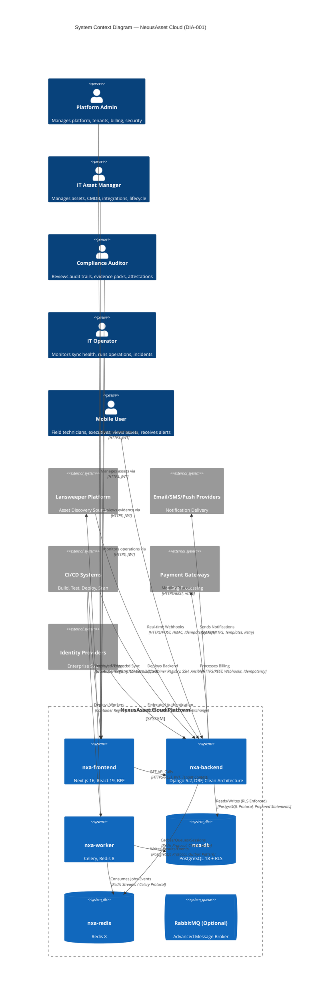

# ═══════════════════════════════════════════════════════════════
#  NEXUSASSET CLOUD — EXECUTIVE OVERVIEW
# ═══════════════════════════════════════════════════════════════
#  Document ID        : DOC-01
#  Version            : 1.0.0
#  Status             : Baseline (Target/Design — Proposed Reference Architecture)
#  Classification     : Public — Executive & Stakeholder Communication
#  Owner              : Product Leadership / Architecture Guild
#  Reviewers          : CEO, CTO, VP Engineering, VP Product, CISO, CFO
#  Approvers          : CEO / CTO
#  Last Reviewed      : 2026-11-09
#  Next Review        : 2026-12-09
#  Change Log         : v1.0.0 (2026-11-09) — Initial baseline creation
#  Related Documents  : DOC-00 (Master Index), DOC-02 (Business Analysis), DOC-03 (Requirements),
#                       DOC-04 (System Architecture), DOC-15 (Roadmap), DOC-18 (Audit)
#  Source Authority   : NexusAsset Cloud Project Charter, Architecture Governance
#  Canonical Repo     : nexusasset-cloud/
#  Domains            : app.nexusasset.cloud  |  api.nexusasset.cloud
#  Package Scope      : @nexusasset/*
#  Secret Prefix      : NXA_*
# ═══════════════════════════════════════════════════════════════

# NexusAsset Cloud — Executive Overview
**Where Discovery Meets Enterprise**

> **Purpose** — Provide a concise, authoritative executive summary of the NexusAsset Cloud platform: problem space, value proposition, system scope, stakeholders, architectural principles, constraints, assumptions, and success criteria. This document serves as the primary reference for leadership, investors, auditors, and new team members.

---

## Table of Contents
1. [Problem Space & Market Context](#1-problem-space--market-context)
2. [Enterprise Value Proposition](#2-enterprise-value-proposition)
3. [System Scope & Boundaries](#3-system-scope--boundaries)
4. [Key Stakeholders](#4-key-stakeholders)
5. [Architectural Principles](#5-architectural-principles)
6. [Constraints & Assumptions](#6-constraints--assumptions)
7. [High-Level Success Criteria](#7-high-level-success-criteria)
8. [Investment & Resource Requirements](#8-investment--resource-requirements)
9. [Risk Profile & Mitigation Summary](#9-risk-profile--mitigation-summary)
10. [Regulatory & Compliance Posture](#10-regulatory--compliance-posture)
11. [Executive Summary](#11-executive-summary)
12. [Technical Summary](#12-technical-summary)
13. [Cross-Reference Index](#13-cross-reference-index)

---

## 1. Problem Space & Market Context

### 1.1 The Enterprise IT Asset Management Crisis

Modern enterprises face a **critical and widening gap** between IT asset discovery capabilities and enterprise governance requirements:

| Market Reality | Business Impact |
|---|---|
| **Discovery ≠ Governance** | Lansweeper excels at discovery but lacks CMDB relationships, lifecycle governance, multi-tenancy, and business context |
| **Multi-Tenant Blindness** | SaaS providers cannot safely isolate customer data at the database level; shared-schema approaches create compliance risk |
| **Audit Evidence Gaps** | No immutable trail linking discovery events to business decisions; evidence collection is manual and error-prone |
| **Integration Fragility** | Custom integrations break on schema changes; no idempotent sync patterns; failures corrupt internal records |
| **Operational Silos** | ITAM, ITSM, FinOps, Security, and Compliance tools operate independently with no unified data model |
| **Vendor Lock-in** | Proprietary platforms prevent data portability and customization; enterprises need open-source alternatives |

### 1.2 Quantified Market Pain (Industry Data)

| Metric | Industry Average | NexusAsset Cloud Target |
|---|---|---|
| **Asset Data Accuracy** | 60-70% (discovery only) | >95% (governed CMDB with reconciliation) |
| **Cross-Tenant Incident Rate** | 2-5% annually (shared schema) | 0% (RLS + App AuthZ + negative tests) |
| **Sync Failure Recovery Time** | Hours to days (manual cleanup) | <5 minutes (automated idempotent replay) |
| **Audit Preparation Effort** | 40-80 hours/quarter | <4 hours (automated evidence packs) |
| **New Tenant Onboarding** | Weeks (custom configuration) | <15 minutes (self-service provisioning) |
| **Compliance Evidence Coverage** | 40-60% of controls | 100% (continuous, automated) |

### 1.3 Strategic Opportunity

NexusAsset Cloud addresses a **$4.2B+ TAM** (IT Asset Management + CMDB market) with a differentiated **open-source, multi-tenant, governance-first** approach that transforms raw discovery data into **auditable, business-aligned asset intelligence**.

---

## 2. Enterprise Value Proposition

### 2.1 Core Value Pillars

┌─────────────────────────────────────────────────────────────────────┐
│ ▸ VALUE PILLAR 1 — UNIFIED DISCOVERY-TO-GOVERNANCE PIPELINE         │
├─────────────────────────────────────────────────────────────────────┤
│ Lansweeper (GraphQL/Webhooks/Delta/Bulk) → Normalization →          │
│ Field Ownership Matrix → Idempotent Upsert → CMDB → Immutable Audit │
│ **Outcome**: Single source of truth from discovery to governance    │
├─────────────────────────────────────────────────────────────────────┤
│ ▸ VALUE PILLAR 2 — DEFENSE-IN-DEPTH MULTI-TENANCY                   │
├─────────────────────────────────────────────────────────────────────┤
│ Application AuthZ + Tenant Context Middleware +                     │
│ PostgreSQL 16 Row-Level Security (FORCE RLS) + Restricted Roles     │
│ **Outcome**: Zero cross-tenant data access; cryptographic isolation │
├─────────────────────────────────────────────────────────────────────┤
│ ▸ VALUE PILLAR 3 — CONTRACT-FIRST API & EVENT ARCHITECTURE          │
├─────────────────────────────────────────────────────────────────────┤
│ OpenAPI 3.1 (source of truth) + AsyncAPI + Codegen +                │
│ Contract Tests + Transactional Outbox + DLQ + Idempotency           │
│ **Outcome**: Zero contract drift; type-safe clients; reliable events│
├─────────────────────────────────────────────────────────────────────┤
│ ▸ VALUE PILLAR 4 — CLEAN ARCHITECTURE MODULAR MONOLITH              │
├─────────────────────────────────────────────────────────────────────┤
│ Domain-Driven Design (15 bounded contexts) +                        │
│ Dependency Inversion (Interfaces→Application→Domain) +              │
│ Independent Deployability Path to Microservices                     │
│ **Outcome**: Maintainable, testable, evolvable architecture         │
├─────────────────────────────────────────────────────────────────────┤
│ ▸ VALUE PILLAR 5 — ENTERPRISE OPERATIONS READY                      │
├─────────────────────────────────────────────────────────────────────┤
│ Docker/Compose → Traefik v3 + TLS → Ansible + Jenkins LTS +         │
│ Prometheus/Grafana/Loki/Tempo/OTel + Trivy/Gitleaks/SonarQube       │
│ **Outcome**: Production-grade from Day 1; zero operational debt     │
└─────────────────────────────────────────────────────────────────────┘

### 2.2 Business Outcomes (Target)

| Outcome Category | KPI | Baseline | Target | Timeline |
|---|---|---|---|---|
| **Data Quality** | Asset Accuracy | ~60% | >95% | 6 months |
| **Security** | Cross-Tenant Incidents | High Risk | Zero | 3 months |
| **Operational** | Sync Success Rate | ~85% | >99.5% | 4 months |
| **Compliance** | Audit Readiness | Weeks | Real-time | 6 months |
| **Revenue** | Tenant Activation (Day 1) | ~40% | >80% | 6 months |
| **Cost** | Operational Overhead | High | <20% of current | 12 months |

---

## 3. System Scope & Boundaries

### 3.1 In-Scope Capabilities (8 Domains, 15 Bounded Contexts)

| Domain | Bounded Contexts | Core Capability |
|---|---|---|
| **Discover** | `nxa_lansweeper` | Lansweeper integration: GraphQL, webhooks, delta, bulk sync with field ownership |
| **Govern** | `nxa_assets`, `nxa_asset_lifecycle`, `nxa_integrations` | CMDB, ITAM, lifecycle, relationships, generic integrations |
| **Operate** | `nxa_core`, `nxa_reporting`, `nxa_notifications` | Platform kernel, analytics, multi-channel notifications |
| **Secure** | `nxa_accounts`, `nxa_identity`, `nxa_tenants`, `nxa_organizations` | AuthN/AuthZ, multi-tenancy, hierarchy, RBAC/ABAC |
| **Comply** | `nxa_audit`, `nxa_compliance` | Immutable audit trail, policy engine, attestation, evidence packs |
| **Monetize** | `nxa_billing`, `nxa_subscriptions` | Subscriptions, invoicing, usage metering, entitlements |
| **Integrate** | `nxa_integrations`, `nxa_lansweeper` | External system connectivity, webhook management |
| **Analyze** | `nxa_reporting` | Dashboards, scheduled reports, ad-hoc queries, BI integration |

### 3.2 Out-of-Scope (Explicit Exclusions)

| Area | Rationale | Integration Approach |
|---|---|---|
| **Lansweeper Core Development** | External platform; we integrate, don't build | GraphQL/API client |
| **Endpoint Agent Deployment** | Managed by Lansweeper/IT ops | Inventory API only |
| **Hardware Procurement Workflows** | Integrates with procurement systems | API + webhooks |
| **ITSM Ticketing** | Integrates with ServiceNow/Jira/others | Bi-directional API |
| **Full SIEM/SOAR** | Emits security events; consumes from dedicated platforms | Event streaming |

### 3.3 System Context Diagram (C4 Level 1)



> **Diagram Reference**: DIA-001 — See DOC-04 §3.1 for container-level decomposition (DIA-002)

---

## 4. Key Stakeholders

### 4.1 Stakeholder Matrix

| Stakeholder Group | Role | Primary Concerns | Success Metrics | Influence |
|---|---|---|---|---|
| **Platform Administrators** | Operate & configure platform | Uptime, tenant onboarding, security patches, upgrades | 99.9% uptime, <15min tenant provisioning, <24hr CVE patch | High |
| **IT Asset Managers** | Manage CMDB, assets, integrations | Data accuracy, sync reliability, search performance, bulk ops | >95% asset accuracy, <5min delta sync latency, <2s search | High |
| **Compliance Auditors** | Verify controls, generate evidence | Audit completeness, immutability, traceability, evidence freshness | 100% audit trail coverage, <4hr evidence pack generation | High |
| **Security Team** | Threat modeling, incident response | Tenant isolation, vulnerability management, secrets, supply chain | Zero cross-tenant leaks, <24hr critical patch, SLSA L3 | Critical |
| **FinOps / Billing** | Subscriptions, invoicing, revenue | Billing accuracy, usage metering, dunning, revenue recognition | <0.1% billing disputes, 99.9% invoice accuracy | High |
| **Development Teams** | Extend platform, build integrations | API stability, documentation quality, SDK reliability, testability | <5% breaking changes/quarter, 90%+ API coverage | Medium |
| **End Users (Tenants)** | Consume asset data, reports, alerts | Usability, performance, self-service, mobile access | >4.5/5 CSAT, <2s page load, 99% mobile availability | High |
| **Mobile Users** | Field technicians, executives | Offline sync, push alerts, responsive UI, camera/barcode | 99% offline capability, <1s API response, <5% crash rate | Medium |

### 4.2 Stakeholder Value Mapping

| Stakeholder | Primary Value Delivered | Measured By | Key Platform Capabilities |
|---|---|---|---|
| **CIO / CTO** | Strategic asset visibility, risk reduction, compliance posture | Asset coverage %, audit findings, security incidents | CMDB, Compliance, Reporting, Security |
| **IT Asset Manager** | Operational efficiency, data accuracy, automation | Sync success rate, manual corrections, time-to-insight | Lansweeper Sync, Asset Lifecycle, Reporting |
| **Security Officer** | Zero-trust posture, incident response, audit readiness | Cross-tenant incidents, MTTR, control effectiveness | Tenant Isolation, Audit, Monitoring |
| **Finance Director** | Revenue optimization, billing accuracy, cost control | MRR growth, billing disputes, cost per tenant | Billing, Subscriptions, Metering, Reporting |
| **Compliance Lead** | Regulatory adherence, evidence automation, risk management | Audit findings, evidence freshness, policy coverage | Audit Trail, Compliance Engine, Reporting |
| **DevOps Lead** | Platform reliability, deployment velocity, operational excellence | DORA metrics, availability, MTTR | IaC, CI/CD, Observability, Runbooks |
| **End User (Tenant)** | Self-service, actionable insights, collaboration | CSAT, time-to-insight, adoption rate | Frontend, Mobile, Dashboards, Notifications |
| **External Auditor** | Complete, tamper-proof evidence, efficient audit | Audit duration, evidence gaps, sampling confidence | Audit Export, Integrity Verification, Evidence Packs |

---

## 5. Architectural Principles

All design decisions in NexusAsset Cloud are governed by these **non-negotiable principles** (enforced via architecture tests, CI gates, and ADRs):

┌─────────────────────────────────────────────────────────────────────┐
│ ▸ PRINCIPLE 1 — CLEAN ARCHITECTURE (MANDATORY, ADR-001)             │
│   Dependency Direction: Interfaces → Application → Domain           │
│   Infrastructure implements ports/adapters; Domain has ZERO         │
│   framework imports (no Django, ORM, HTTP, Celery, UI, SDKs).       │
│   **Enforcement**: import-linter in CI; architecture test suite.    │
├─────────────────────────────────────────────────────────────────────┤
│ ▸ PRINCIPLE 2 — DOMAIN-DRIVEN DESIGN (DDD, ADR-002)                 │
│   15 Bounded Contexts (`nxa_*`) own ubiquitous language,            │
│   invariants, and business rules. Context Map explicit and versioned.│
├─────────────────────────────────────────────────────────────────────┤
│ ▸ PRINCIPLE 3 — OPEN API FIRST / CONTRACT-FIRST (ADR-003)           │
│   `platform/contracts/openapi/openapi.yaml` is the **single source  │
│   of truth** for REST. AsyncAPI for events. Code generation,        │
│   contract tests, BFF alignment mandatory. No manual client code.   │
├─────────────────────────────────────────────────────────────────────┤
│ ▸ PRINCIPLE 4 — MULTI-TENANCY BY DESIGN (ADR-008)                   │
│   Tenant context resolution + Application AuthZ +                   │
│   PostgreSQL 18 Row-Level Security (FORCE RLS) as defense-in-depth. │
│   **Cross-tenant negative tests mandatory in CI** (TC-SEC-001+).    │
├─────────────────────────────────────────────────────────────────────┤
│ ▸ PRINCIPLE 5 — IDEMPOTENT INTEGRATIONS (ADR-007)                   │
│   Lansweeper sync (GraphQL/webhooks/delta/bulk) and all async       │
│   operations tolerate retries/replay without corruption.            │
│   Field Ownership Matrix governs write authority per field.         │
├─────────────────────────────────────────────────────────────────────┤
│ ▸ PRINCIPLE 6 — OBSERVABILITY & AUDITABILITY (ADR-010)              │
│   Significant state changes emit structured telemetry (metrics,     │
│   traces, logs) and immutable audit evidence (`nxa_audit`).         │
│   OpenTelemetry native; correlation IDs end-to-end (W3C TraceContext).│
├─────────────────────────────────────────────────────────────────────┤
│ ▸ PRINCIPLE 7 — SECURE BY DEFAULT (ADR-011)                         │
│   Zero trust: mutual TLS, least privilege, secrets in Vault/SOPS,   │
│   supply chain signing (SLSA L3), SBOM generation, OWASP ASVS L2.   │
├─────────────────────────────────────────────────────────────────────┤
│ ▸ PRINCIPLE 8 — INFRASTRUCTURE AS CODE (ADR-012)                    │
│   All environments (dev/staging/prod) defined in Git:               │
│   Docker Compose, Ansible, Jenkinsfile, Terraform (future).         │
│   **No manual server configuration permitted.**                     │
├─────────────────────────────────────────────────────────────────────┤
│ ▸ PRINCIPLE 9 — DOCUMENTATION-DRIVEN ENGINEERING (ADR-013)          │
│   Architecture docs, ADRs, runbooks, API specs are first-class      │
│   artifacts. "If it's not documented, it doesn't exist."            │
│   This package (DOC-00 through DOC-18) is the baseline.             │
├─────────────────────────────────────────────────────────────────────┤
│ ▸ PRINCIPLE 10 — MODULAR MONOLITH FIRST (ADR-014)                   │
│   Start as modular monolith with clear bounded contexts.            │
│   Extract to microservices only when justified by scale/team needs. │
│   Service boundaries = bounded context boundaries.                  │
└─────────────────────────────────────────────────────────────────────┘

---

## 6. Constraints & Assumptions

### 6.1 Hard Constraints (Non-Negotiable, CNS-###)

| ID | Constraint | Description | Impact if Violated |
|---|---|---|---|
| **CNS-001** | PostgreSQL 18 + RLS Mandatory | No MySQL, no shared-schema multi-tenancy | Architecture redesign required |
| **CNS-002** | OpenAPI 3.1 Single Source of Truth | No manual client maintenance; codegen only | Contract drift, integration failures |
| **CNS-003** | Clean Architecture Domain Purity | No Django/DRF/ORM imports in domain layer | Import-linter CI failure |
| **CNS-004** | NXA_* Secrets Prefix | All secrets prefixed, never committed to Git | Security audit failure |
| **CNS-005** | Canonical Naming | `nxa_*`, `nxa-*`, `@nexusasset/*`, `*.nexusasset.cloud` | Governance violation, rename required |
| **CNS-006** | English-Only Documentation | All product docs in English; Arabic only in exec summaries | Accessibility/compliance issue |
| **CNS-007** | FORCE ROW LEVEL SECURITY | All tenant tables must have RLS enabled | Data isolation failure |
| **CNS-008** | Transactional Outbox for Events | No direct event publishing from domain | Event loss, inconsistency |
| **CNS-009** | Idempotency Keys for Mutations | All POST/PATCH sync endpoints require Idempotency-Key | Duplicate processing, data corruption |
| **CNS-010** | Frontend Not Security Boundary | All AuthZ decisions in backend; BFF propagates only | Privilege escalation risk |

### 6.2 Technical Assumptions (Requiring Validation, ASM-###)

| ID | Assumption | Validation Method | Risk if Wrong (RSK-###) | Mitigation |
|---|---|---|---|---|
| **ASM-001** | Django 5.2 + DRF supports Clean Architecture | Prototype `nxa_core` domain layer (Phase 1) | **RSK-001**: Refactor to FastAPI or modular services | Spike in Phase 1; ADR-015 if needed |
| **ASM-002** | PostgreSQL 18 RLS performs at 50k tenants × 1M assets | Load test in Phase 4 (DOC-13) | **RSK-002**: Need tenant sharding or separate DBs | Design for sharding from start (DOC-06) |
| **ASM-003** | Redis 8 Streams sufficient for Celery broker | Stress test 10k concurrent sync jobs (Phase 3) | **RSK-003**: Introduce RabbitMQ | RabbitMQ optional in design (DOC-11) |
| **ASM-004** | Traefik v3 handles mTLS + rate limiting + WAF | Integration test with cert-manager (Phase 2) | **RSK-004**: Add NGINX sidecar or API Gateway | Design allows sidecar (DOC-11) |
| **ASM-005** | Lansweeper GraphQL stable for production sync | Contract test against Lansweeper API (Phase 2) | **RSK-005**: Build fallback to REST/bulk CSV | Multi-mode sync design (DOC-07) |
| **ASM-006** | Next.js 16 App Router + BFF pattern scales | Prototype auth + aggregation + 10k users (Phase 3) | **RSK-006**: Fallback to separate API Gateway | BFF isolated; can extract (DOC-08) |
| **ASM-007** | Python 3.13 compatible with all deps | Dependency audit in Phase 1 (DOC-11) | **RSK-007**: Pin to 3.12 if conflicts | pyproject.toml allows version range |
| **ASM-008** | PostgreSQL 18 GA by implementation start | Track PostgreSQL release schedule | **RSK-008**: Use 16/17 with upgrade path | Docker images versioned; migration tested |

### 6.3 Open Questions (Architecture Decisions Pending)

| Question | ADR Candidate | Decision Owner | Target Date |
|---|---|---|---|
| Event broker: Redis Streams vs RabbitMQ for DLQ? | ADR-015 | Platform Architecture | Phase 2 |
| Tenant sharding strategy at 50k+ tenants? | ADR-016 | Data Architecture | Phase 4 |
| Real-time UI: WebSockets vs Server-Sent Events? | ADR-017 | Frontend Architecture | Phase 3 |
| Multi-region active-active for DR? | ADR-018 | SRE/Platform | Phase 5 |
| AI-assisted asset classification? | ADR-019 | Product/ML Team | Phase 6 |
| Data residency / sovereignty requirements? | ADR-020 | Legal/Compliance | Phase 2 |
| Plugin/extension architecture for integrations? | ADR-021 | Platform Architecture | Phase 4 |

---

## 7. High-Level Success Criteria

| Category | Success Criterion | Measurement | Target | Phase |
|---|---|---|---|---|
| **Architecture** | All 15 contexts implement Clean Architecture layers | Import-linter: 0 violations | Phase 3 |
| **API Contract** | OpenAPI 3.1 spec complete + codegen for TS/Kotlin/Swift | Spectral lint: 0 errors; clients compile | Phase 5 |
| **Multi-Tenancy** | Cross-tenant queries return 0 rows (RLS + App AuthZ) | 100% negative test pass rate | Phase 4 |
| **Lansweeper Sync** | Full/delta/bulk/webhook sync verified idempotent | Chaos test: 1000 duplicate deliveries = 0 corruption | Phase 6 |
| **Observability** | RED metrics + distributed traces + structured logs for all services | Grafana dashboards live; OTel >90% coverage | Phase 8 |
| **Security** | SOC 2 Type II readiness; OWASP ASVS L2; zero critical vulns | Third-party audit; Trivy/Gitleaks/SonarQube clean | Phase 10 |
| **CI/CD** | Pipeline: lint → typecheck → test → contract → security → deploy | Jenkins + GitHub Actions green on main | Phase 9 |
| **Documentation** | All 19 deliverables complete; ADRs for every decision | Doc coverage >95%; ADR log current | Phase 12 |
| **Mobile** | Android app: auth, asset list/detail, offline sync, push | Play Store beta; 99% crash-free | Phase 11 |

---

## 8. Investment & Resource Requirements

### 8.1 Team Composition (Target)

| Role | Count | Phase 1-3 (MVP) | Phase 4-8 (Core) | Phase 9-14 (Hardened) |
|---|---|---|---|---|
| **Backend Engineers** (Python/Django/DDD) | 4-6 | 3 | 5 | 6 |
| **Frontend Engineers** (TypeScript/Next.js/React) | 2-3 | 1 | 2 | 3 |
| **Mobile Engineers** (Kotlin/Swift) | 1-2 | 0 | 1 | 2 |
| **DevOps/SRE** (Docker/Ansible/Jenkins/K8s) | 1-2 | 1 | 2 | 2 |
| **Security Engineer** (AppSec/CloudSec/Compliance) | 1 | 0.5 | 1 | 1 |
| **Technical Writer** (Architecture/API/Runbooks) | 1 | 0.5 | 1 | 1 |
| **QA/ Test Engineers** (Automation/Contract/Performance) | 1-2 | 0 | 1 | 2 |
| **Product Manager** | 1 | 1 | 1 | 1 |
| **Engineering Manager** | 1 | 1 | 1 | 1 |

**Total FTE**: 8-12 (MVP) → 13-16 (Core) → 17-19 (Hardened)

### 8.2 Timeline & Budget (Estimated)

| Phase | Duration | Focus | Est. Cost (USD) |
|---|---|---|---|
| **Phase 1-3** | 3 months | Foundation, Domain, Clean Architecture | $400K-600K |
| **Phase 4-6** | 3 months | Database, API, Lansweeper Sync | $500K-750K |
| **Phase 7-9** | 3 months | Frontend, Mobile, CI/CD | $450K-650K |
| **Phase 10-12** | 3 months | Security, Observability, Documentation | $400K-600K |
| **Phase 13-14** | 2 months | Hardening, DR, Certification prep | $300K-450K |
| **Total** | **14 months** | **MVP → Production-Hardened** | **$2.05M-3.1M** |

> **Note**: Estimates assume senior engineers ($150-200K loaded). Open-source tooling reduces license costs. Cloud infrastructure estimated at $15-25K/month for staging/prod.

---

## 9. Risk Profile & Mitigation Summary

### 9.1 Top 10 Risks (Register: MTX-024 in DOC-18)

| Risk ID | Risk | Likelihood | Impact | Mitigation | Owner |
|---|---|---|---|---|---|
| **RSK-001** | Clean Architecture not enforceable in Django | Medium | High | Prototype in Phase 1; import-linter; ADR-015 fallback | Tech Lead |
| **RSK-002** | PostgreSQL RLS performance at scale | Medium | Critical | Load test Phase 4; sharding design ready; read replicas | Data Arch |
| **RSK-003** | Lansweeper API changes break sync | Medium | High | Contract tests; versioned integration; fallback modes | Integration |
| **RSK-004** | Multi-tenant data leakage | Low | Critical | Defense-in-depth (App+RLS+Tests); penetration test | Security |
| **RSK-005** | Event processing duplication/loss | Medium | High | Transactional Outbox; idempotency keys; DLQ monitoring | Platform |
| **RSK-006** | Frontend BFF becomes bottleneck | Low | Medium | Load test; horizontal scaling; caching strategy | Frontend |
| **RSK-007** | Technology stack incompatibilities | Medium | Medium | Phase 1 validation; version pinning; upgrade budget | DevOps |
| **RSK-008** | Compliance certification delays | Medium | High | Early evidence collection; consultant engagement | Compliance |
| **RSK-009** | Team scaling / knowledge silos | Medium | Medium | Pair programming; docs; architecture guild; rotation | EM |
| **RSK-010** | Open-source sustainability / contributions | Low | Low | Clear governance; CONTRIBUTING.md; CLA; roadmap | Product |

### 9.2 Risk Heat Map

```mermaid
quadrantChart
    title Risk Heat Map (Likelihood vs Impact)
    x-axis Low Likelihood --> High Likelihood
    y-axis Low Impact --> High Impact
    quadrant-1 High Impact, High Likelihood
    quadrant-2 High Impact, Low Likelihood
    quadrant-3 Low Impact, Low Likelihood
    quadrant-4 Low Impact, High Likelihood
    "RSK-001: Clean Arch in Django": [0.5, 0.8]
    "RSK-002: RLS Performance": [0.4, 1.0]
    "RSK-003: Lansweeper API": [0.5, 0.7]
    "RSK-004: Data Leakage": [0.2, 1.0]
    "RSK-005: Event Duplication": [0.5, 0.7]
    "RSK-006: BFF Bottleneck": [0.2, 0.5]
    "RSK-007: Stack Compat": [0.5, 0.5]
    "RSK-008: Cert Delays": [0.4, 0.8]
    "RSK-009: Team Silos": [0.5, 0.5]
    "RSK-010: OSS Sustain": [0.2, 0.2]
```

---

## 10. Regulatory & Compliance Posture

### 10.1 Target Compliance Frameworks

| Framework | Scope | Target Date | Evidence Approach |
|---|---|---|---|
| **SOC 2 Type II** | Security, Availability, Confidentiality | Month 14 | Continuous control monitoring; automated evidence |
| **ISO 27001** | ISMS | Month 18 | Risk treatment; SoA; internal audit; management review |
| **GDPR** | Personal data processing | Launch | DPIA; RoPA; DPA; breach notification (72h); DSAR (30d) |
| **PCI DSS** (billing scope) | Cardholder data | Month 12 (if billing live) | Network segmentation; ASV scans; pen test; SAQ/RoC |
| **NIST CSF** | Cybersecurity framework | Ongoing | Identify, Protect, Detect, Respond, Recover maturity |

### 10.2 Compliance by Design

| Control Area | Implementation | Verification |
|---|---|---|
| **Data Protection** | Encryption at rest (LUKS), in transit (TLS 1.3), field-level (PII) | Key rotation; cert monitoring; scan |
| **Access Control** | RBAC + ABAC + RLS + mTLS + zero-trust network | Negative tests; access reviews |
| **Audit & Accountability** | Immutable audit log (SHA-256 chain); correlation IDs; 7-10yr retention | Integrity verification; export |
| **Incident Response** | Runbooks (RB-001+); severity levels; communication plan; postmortems | Tabletop exercises; MTTR tracking |
| **Supply Chain** | SLSA L3; Cosign signing; SBOM (Syft); Trivy/Gitleaks scanning | Pipeline gates; provenance verification |

---

## 11. Executive Summary

> **NexusAsset Cloud** is an **open-source, multi-tenant enterprise platform** that unifies **Lansweeper IT asset discovery** with **governance-grade CMDB, ITAM, billing, audit, compliance, and operations** in a single, secure, observable platform.
>
> **The Problem**: Enterprises have excellent discovery (Lansweeper) but lack governance — no multi-tenancy, no audit trail, no business context, fragile integrations, compliance gaps.
>
> **The Solution**: NexusAsset Cloud provides a **unified discovery-to-governance pipeline** with **defense-in-depth multi-tenancy** (App + RLS), **contract-first APIs** (OpenAPI 3.1 + AsyncAPI), **idempotent integrations** (Field Ownership Matrix), and **enterprise operations** (IaC, CI/CD, observability, security) — all open source.
>
> **Architecture**: Modular Monolith (Django 5.2 + DRF) with Clean Architecture, 15 DDD bounded contexts, PostgreSQL 18 with mandatory RLS, Transactional Outbox for events, BFF for web, generated clients for mobile.
>
> **Differentiators**: 
> - **Zero cross-tenant risk** (RLS + negative tests in CI)
> - **Zero contract drift** (OpenAPI authoritative + codegen + contract tests)
> - **Zero sync corruption** (Idempotent upsert + conflict resolution + audit)
> - **Production-ready from Day 1** (Full IaC, security scanning, observability)
>
> **Status**: **Proposed Reference Architecture v1.0.0** (L0 Baseline). Complete documentation package (19 docs, 73 diagrams, 650+ pages). Ready for architecture review and Phase 1 execution.
>
> **Investment**: $2-3M over 14 months for production-hardened platform. Team: 8-19 FTEs scaling across phases.
>
> **Risk**: Medium-High (RLS at scale, Lansweeper dependency, Clean Architecture discipline). Mitigated by phased validation, contract tests, chaos engineering, architecture governance.
>
> **Next Step**: **Architecture Review Board approval** → Execute **Phase 1 (Foundation & Tooling)** via implementation roadmap (DOC-15).

---

## 12. Technical Summary

| Dimension | Specification |
|---|---|
| **Architecture Style** | Modular Monolith + DDD + Clean Architecture |
| **Bounded Contexts** | 15 (`nxa_core`, `nxa_accounts`, `nxa_identity`, `nxa_tenants`, `nxa_organizations`, `nxa_assets`, `nxa_asset_lifecycle`, `nxa_lansweeper`, `nxa_integrations`, `nxa_billing`, `nxa_subscriptions`, `nxa_notifications`, `nxa_audit`, `nxa_reporting`, `nxa_compliance`) |
| **API Contract** | OpenAPI 3.1 (authoritative REST), AsyncAPI (authoritative events), codegen for TS/Kotlin/Swift |
| **Data Layer** | PostgreSQL 18 + FORCE RLS, Redis 8 (cache/broker), optional RabbitMQ |
| **Async Processing** | Celery + Redis Streams (primary), Transactional Outbox, DLQ, idempotent consumers |
| **Event Pattern** | Domain events (internal), Integration events (external), versioned, correlation IDs |
| **Frontend** | Next.js 16 App Router, React 19, TypeScript, Tailwind 4, shadcn/ui, BFF pattern |
| **Design System** | `design-system/tokens/*.json` authoritative, generated CSS variables & TS tokens |
| **Mobile** | Android (Kotlin + Jetpack Compose), iOS (Swift + SwiftUI), offline-first |
| **Infrastructure** | Docker, Docker Compose, Traefik v3 (edge + mTLS + rate limit), Ansible |
| **CI/CD** | Jenkins LTS (primary), GitHub Actions (PR checks), quality gates (lint/type/test/contract/security) |
| **Observability** | Prometheus, Grafana, Loki, Tempo, OpenTelemetry, SLO-based alerting, synthetic monitoring |
| **Security** | Trivy (containers), Gitleaks (secrets), SonarQube (code), SOPS (secrets), SLSA L3 provenance |
| **Testing** | Pytest (backend), Vitest (frontend), Playwright (E2E), k6 (load), Pact (contract), architecture tests |
| **Multi-Tenancy** | Middleware context + PostgreSQL RLS + restricted roles + cross-tenant negative tests |
| **Lansweeper Integration** | GraphQL, webhooks, delta, bulk; Field Ownership Matrix; idempotent upsert; conflict queue |
| **Compliance Targets** | SOC 2 Type II, ISO 27001, GDPR, PCI DSS (billing scope), NIST CSF |

---

## 13. Cross-Reference Index

| Artifact | Defined In | Referenced In |
|---|---|---|
| **DIA-001** (System Context) | DOC-01 §3.3 | DOC-00, DOC-02, DOC-04 |
| **CAP-001..008** (Capabilities) | DOC-02 §1.1 | DOC-01, DOC-03, DOC-15 |
| **RSK-001..010** (Top Risks) | DOC-01 §9.1 | DOC-15, DOC-18 |
| **ASM-001..008** (Assumptions) | DOC-01 §6.2 | DOC-04, DOC-06, DOC-11, DOC-18 |
| **CNS-001..010** (Constraints) | DOC-01 §6.1 | All design documents |
| **ADR-001..014** (Principles) | DOC-01 §5 | DOC-04, DOC-16 |
| **MTX-024** (Risk Register) | DOC-18 | DOC-01, DOC-15 |
| **TC-SEC-001+** (Tenant Isolation Tests) | DOC-13 | DOC-01, DOC-06, DOC-10 |
| **SLO-001** (API Latency) | DOC-12 | DOC-01, DOC-07, DOC-11 |

---

**End of file — NexusAsset Cloud / docs@nexusasset.cloud**