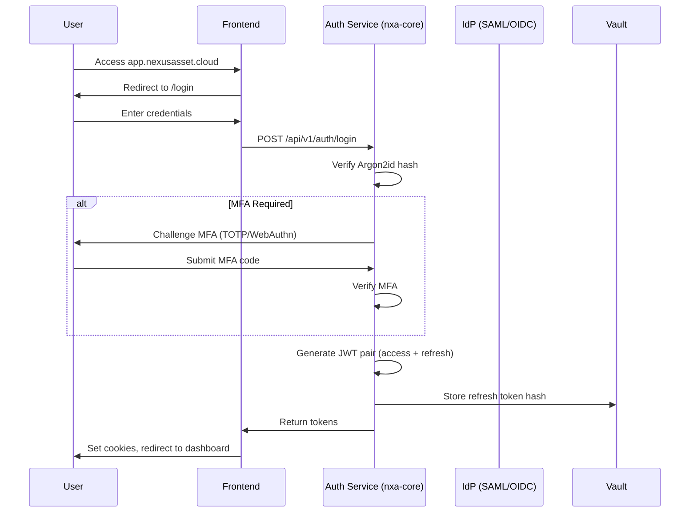
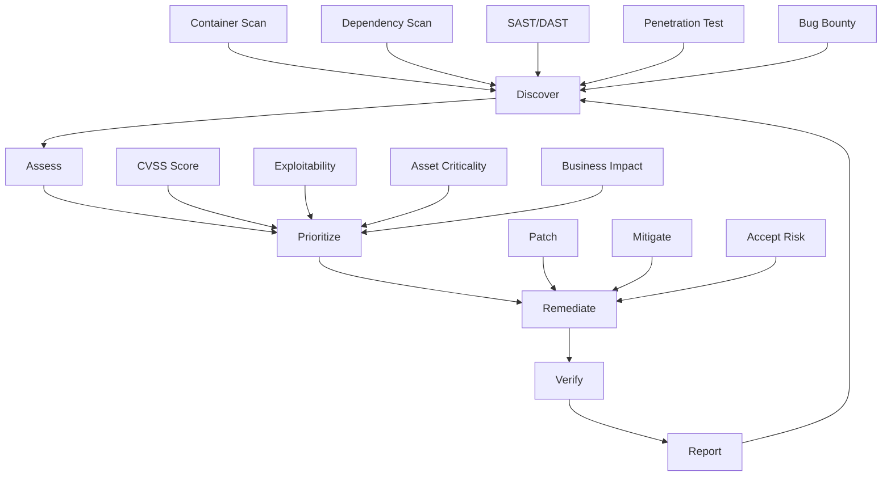

╔═════════════════════════════════════════════════════════════════════════════════════════════════╗
║ Document ID: DOC-12                                                                            ║
║ Title: Security Architecture — Zero Trust, RBAC/ABAC, Encryption, Compliance                   ║
║ Version: 1.0.0                                                                                 ║
║ Status: ✓ Approved                                                                             ║
║ Classification: Internal — Confidential                                                        ║
║ Authors: NexusAsset Cloud Security Team                                                        ║
║ Reviewers: CISO, Platform Engineering, Legal, Compliance, Audit                                ║
║ Approved By: CTO / CISO / Chief Architect                                                      ║
║ Date: 2026-11-09                                                                               ║
║ Supersedes: —                                                                                  ║
║ Related: DOC-00, DOC-01, DOC-02, DOC-03, DOC-04, DOC-05, DOC-06, DOC-07, DOC-11, DOC-13       ║
║ Traceability: REQ-SEC-### ← REQ-NFR-###/CAP-030/050/080, ADR-### → Security Decisions           ║
╚════════════════════════════════════════════════════════════════════════════════════════════════╝

# ═══════════════════════════════════════════════════════════════
# NexusAsset Cloud — Security Architecture (DOC-12)
# ═══════════════════════════════════════════════════════════════

> **Executive Summary** — This document defines the comprehensive security architecture for NexusAsset Cloud, implementing a **Zero Trust** model with **defense in depth** across all layers. The architecture covers: **identity and access management** (RBAC/ABAC, MFA, SSO), **network security** (mTLS, micro-segmentation, WAF), **data protection** (encryption at rest/in transit, key management, tokenization), **application security** (secure SDLC, input validation, CSP), **infrastructure security** (hardened images, runtime protection, vulnerability management), **compliance** (ISO 27001, SOC 2, GDPR, HIPAA, PCI-DSS), and **incident response**. All security controls are implemented as code (policy-as-code via OPA) and continuously validated.

---

## Table of Contents

1. [Security Principles & Model](#1-security-principles--model)
2. [Zero Trust Architecture](#2-zero-trust-architecture)
3. [Identity & Access Management](#3-identity--access-management)
4. [Network Security](#4-network-security)
5. [Data Protection & Encryption](#5-data-protection--encryption)
6. [Application Security](#6-application-security)
7. [Infrastructure Security](#7-infrastructure-security)
8. [Vulnerability Management](#8-vulnerability-management)
9. [Security Monitoring & Detection](#9-security-monitoring--detection)
10. [Incident Response](#10-incident-response)
11. [Compliance & Audit](#11-compliance--audit)
12. [Supply Chain Security](#12-supply-chain-security)
13. [Privacy & Data Governance](#13-privacy--data-governance)
14. [Security Operations](#14-security-operations)
15. [Diagrams](#15-diagrams)
16. [Tables](#16-tables)

---

## 1. Security Principles & Model

### 1.1 Security Principles

| Principle ID | Principle | Implementation |
|--------------|-----------|----------------|
| **SEC-PRIN-001** | **Zero Trust** | Never trust, always verify; explicit verification for every request |
| **SEC-PRIN-002** | **Defense in Depth** | Multiple overlapping security controls at every layer |
| **SEC-PRIN-003** | **Least Privilege** | Minimum permissions required; just-in-time access |
| **SEC-PRIN-004** | **Assume Breach** | Design for detection and containment; not just prevention |
| **SEC-PRIN-005** | **Security as Code** | All policies, configs, controls version-controlled and automated |
| **SEC-PRIN-006** | **Shift Left** | Security integrated in design, development, CI/CD |
| **SEC-PRIN-007** | **Continuous Verification** | Automated compliance checks, drift detection, chaos testing |
| **SEC-PRIN-008** | **Data-Centric Security** | Protect data regardless of location; encryption, classification |
| **SEC-PRIN-009** | **Resilience** | System operates securely under attack; graceful degradation |
| **SEC-PRIN-010** | **Transparency & Auditability** | Complete audit trails; tamper-evident logs |

### 1.2 Security Reference Architecture

```
┌─────────────────────────────────────────────────────────────────────────────────────────────────────┐
│                              SECURITY REFERENCE ARCHITECTURE                                        │
├─────────────────────────────────────────────────────────────────────────────────────────────────────┤
│                                                                                                     │
│  ┌─────────────────────────────────────────────────────────────────────────────────────────────┐   │
│  │                              IDENTITY PLANE                                                  │   │
│  │  ┌─────────────┐  ┌─────────────┐  ┌─────────────┐  ┌─────────────┐  ┌─────────────┐       │   │
│  │  │   SSO/IdP   │  │    MFA      │  │   RBAC/     │  │   Device    │  │   Session   │       │   │
│  │  │  (SAML/OIDC)│  │ (TOTP/WebAuthn)│  │   ABAC      │  │  Trust      │  │  Management │       │   │
│  │  └─────────────┘  └─────────────┘  └─────────────┘  └─────────────┘  └─────────────┘       │   │
│  └─────────────────────────────────────────────────────────────────────────────────────────────┘   │
│                                    │                                                                 │
│                                    ▼                                                                 │
│  ┌─────────────────────────────────────────────────────────────────────────────────────────────┐   │
│  │                              CONTROL PLANE (Policy Decision)                                 │   │
│  │  ┌─────────────────────────────────────────────────────────────────────────────────────┐   │   │
│  │  │                    OPA (Open Policy Agent)                                           │   │   │
│  │  │  • Authorization Policies (Rego)                                                     │   │   │
│  │  │  • Admission Control (K8s)                                                           │   │   │
│  │  │  • Data Filtering (RLS)                                                              │   │   │
│  │  │  • Configuration Validation                                                          │   │   │
│  │  └─────────────────────────────────────────────────────────────────────────────────────┘   │   │
│  └─────────────────────────────────────────────────────────────────────────────────────────────┘   │
│                                    │                                                                 │
│         ┌──────────────────────────┼──────────────────────────┐                                   │
│         ▼                          ▼                          ▼                                   │
│  ┌───────────────┐        ┌───────────────┐        ┌───────────────┐                            │
│  │  DATA PLANE   │        │  NETWORK      │        │  APPLICATION  │                            │
│  │  (Encryption) │        │  (mTLS/Segment)│        │  (WAF/Input   │                            │
│  ├───────────────┤        ├───────────────┤        │   Validation) │                            │
│  │ • AES-256     │        │ • Cilium mTLS │        │ • CSP/HSTS    │                            │
│  │ • Per-tenant  │        │ • NetworkPolicy│        │ • Rate Limit  │                            │
│  │   DEK/KEK     │        │ • Egress Ctrl │        │ • Input Val   │                            │
│  │ • HSM/KMS     │        │ • Zero Trust  │        │ • Output Enc  │                            │
│  │ • Tokenization│        │   Network     │        │ • Sec Headers │                            │
│  └───────────────┘        └───────────────┘        └───────────────┘                            │
│         │                          │                          │                                   │
│         └──────────────────────────┼──────────────────────────┘                                   │
│                                    ▼                                                                 │
│  ┌─────────────────────────────────────────────────────────────────────────────────────────────┐   │
│  │                        OBSERVABILITY & RESPONSE                                             │   │
│  │  ┌─────────────┐  ┌─────────────┐  ┌─────────────┐  ┌─────────────┐  ┌─────────────┐       │   │
│  │  │   SIEM      │  │   SOAR      │  │   Threat    │  │   Forensics │  │   Compliance│       │   │
│  │  │  (Splunk/   │  │  (Automated │  │   Intel     │  │  (Immutable │  │  (Continuous│       │   │
│  │  │   Elastic)  │  │   Response) │  │  (Feeds)    │  │   Logs)     │  │   Monitoring)│      │   │
│  │  └─────────────┘  └─────────────┘  └─────────────┘  └─────────────┘  └─────────────┘       │   │
│  └─────────────────────────────────────────────────────────────────────────────────────────────┘   │
│                                                                                                     │
└─────────────────────────────────────────────────────────────────────────────────────────────────────┘
```

---

## 2. Zero Trust Architecture

### 2.1 Zero Trust Principles Applied

| Principle | Implementation | Technology |
|-----------|----------------|------------|
| **Verify Explicitly** | Every request authenticated & authorized | JWT + mTLS + OPA |
| **Least Privilege Access** | RBAC + ABAC + JIT access | OPA policies, feature flags |
| **Assume Breach** | Micro-segmentation, encryption, monitoring | Cilium, AES-256, SIEM |
| **Continuous Validation** | Real-time policy evaluation, drift detection | OPA, Kyverno, Falco |

### 2.2 Zero Trust Network Access (ZTNA)

```
┌─────────────────────────────────────────────────────────────────────────────────────────────────────┐
│                              ZERO TRUST NETWORK ACCESS FLOW                                         │
├─────────────────────────────────────────────────────────────────────────────────────────────────────┤
│                                                                                                     │
│  USER/DEVICE                                                                                        │
│     │                                                                                               │
│     ▼                                                                                               │
│  ┌─────────────────────────────────────────────────────────────────────────────────────────────┐   │
│  │                    IDENTITY PROVIDER (IdP)                                                  │   │
│  │  • Primary auth (password + MFA)                                                            │   │
│  │  • Device posture check (MDM/EDR)                                                          │   │
│  │  • Location, time, risk score                                                              │   │
│  │  • Issues short-lived certificate (SPIFFE)                                                 │   │
│  └─────────────────────────────────────────────────────────────────────────────────────────────┘   │
│     │                                                                                               │
│     ▼                                                                                               │
│  ┌─────────────────────────────────────────────────────────────────────────────────────────────┐   │
│  │                    POLICY ENFORCEMENT POINT (PEP)                                           │   │
│  │  • Traefik Ingress + Cilium CNI                                                             │   │
│  │  • Terminates TLS, validates mTLS                                                          │   │
│  │  • Extracts SPIFFE identity                                                                │   │
│  │  • Forwards auth decision request to PDP                                                   │   │
│  └─────────────────────────────────────────────────────────────────────────────────────────────┘   │
│     │                                                                                               │
│     ▼                                                                                               │
│  ┌─────────────────────────────────────────────────────────────────────────────────────────────┐   │
│  │                    POLICY DECISION POINT (PDP)                                              │   │
│  │  • OPA evaluates Rego policies                                                             │   │
│  │  • Context: user, device, resource, action, time, location                                │   │
│  │  • Returns: ALLOW/DENY + obligations (logging, rate limit)                                 │   │
│  └─────────────────────────────────────────────────────────────────────────────────────────────┘   │
│     │                                                                                               │
│     ▼                                                                                               │
│  ┌─────────────────────────────────────────────────────────────────────────────────────────────┐   │
│  │                    POLICY INFORMATION POINT (PIP)                                           │   │
│  │  • User attributes (IdP, HR system)                                                        │   │
│  │  • Device posture (MDM, EDR)                                                               │   │
│  │  • Resource metadata (CMDB, tags)                                                          │   │
│  │  • Threat intelligence feeds                                                               │   │
│  └─────────────────────────────────────────────────────────────────────────────────────────────┘   │
│     │                                                                                               │
│     ▼                                                                                               │
│  RESOURCE (Backend API, Database, etc.)                                                            │
│                                                                                                     │
└─────────────────────────────────────────────────────────────────────────────────────────────────────┘
```

### 2.3 SPIFFE/SPIRE Workload Identity

```yaml
# platform/kubernetes/spire/spire-agent.yaml
apiVersion: spire.spiffe.io/v1
kind: ClusterSPIFFEID
metadata:
  name: nxa-workload-identity
spec:
  trustDomain: nexusasset.cloud
  namespaceSelector:
    matchLabels:
      workload: "true"
  podSelector:
    matchLabels:
      app.kubernetes.io/part-of: nexusasset
  dnsNames:
    - "*.nxa-backend.svc.cluster.local"
    - "*.nxa-frontend.svc.cluster.local"
    - "*.nxa-worker.svc.cluster.local"
  federatesWith:
    - trustDomain: "partner.example.com"
      bundleEndpoint: "https://spire.partner.example.com/bundle"
```

---

## 3. Identity & Access Management

### 3.1 Authentication Architecture



### 3.2 RBAC/ABAC Model

| Component | Description | Implementation |
|-----------|-------------|----------------|
| **Roles** | Named collections of permissions | `asset_manager`, `tenant_admin`, `compliance_officer` |
| **Permissions** | `resource:action:scope` format | `assets:read:own`, `assets:write:*`, `tenants:read:all` |
| **Scopes** | `own`, `team`, `tenant`, `platform` | Hierarchical |
| **Attributes** | User, resource, environment attributes | Tags, location, risk score, time |
| **Policies** | Rego rules evaluating attributes | OPA policies per context |

### 3.3 Permission Matrix

| Permission | Asset Manager | Tenant Admin | Compliance Officer | Platform Admin |
|------------|---------------|--------------|-------------------|----------------|
| `assets:read:own` | ✅ | ✅ | ✅ | ✅ |
| `assets:read:tenant` | ✅ | ✅ | ✅ | ✅ |
| `assets:write:own` | ✅ | ✅ | ❌ | ✅ |
| `assets:write:tenant` | ❌ | ✅ | ❌ | ✅ |
| `assets:delete` | ❌ | ✅ | ❌ | ✅ |
| `assets:authorize` | ✅ | ✅ | ❌ | ✅ |
| `tenants:read` | ❌ | ✅ | ✅ | ✅ |
| `tenants:write` | ❌ | ✅ | ❌ | ✅ |
| `billing:read` | ❌ | ✅ | ❌ | ✅ |
| `billing:write` | ❌ | ✅ | ❌ | ✅ |
| `compliance:read` | ❌ | ✅ | ✅ | ✅ |
| `compliance:write` | ❌ | ❌ | ✅ | ✅ |
| `audit:read` | ❌ | ❌ | ✅ | ✅ |
| `platform:*` | ❌ | ❌ | ❌ | ✅ |

### 3.4 Just-In-Time (JIT) Access

```python
# backend/nexusasset/accounts/domain/services/jit_access.py
class JITAccessService:
    @staticmethod
    def request_elevated_access(
        user_id: UserId,
        target_role: RoleId,
        justification: str,
        duration_minutes: int,
        approver_id: UserId
    ) -> JITAccessRequest:
        """Request temporary elevated access"""
        if duration_minutes > 480:  # Max 8 hours
            raise ValueError("Maximum duration is 8 hours")
        
        request = JITAccessRequest(
            id=JITAccessRequestId.generate(),
            user_id=user_id,
            target_role=target_role,
            justification=justification,
            requested_duration=timedelta(minutes=duration_minutes),
            status=JITStatus.PENDING_APPROVAL,
            approver_id=approver_id,
            requested_at=utc_now()
        )
        
        JITAccessRepository.save(request)
        
        # Notify approver
        EventPublisher.publish(JITAccessRequestedEvent(request=request))
        
        return request
    
    @staticmethod
    def approve_request(request_id: JITAccessRequestId, approver_id: UserId) -> JITAccessGrant:
        request = JITAccessRepository.get(request_id)
        
        if request.status != JITStatus.PENDING_APPROVAL:
            raise InvalidStateError("Request not pending")
        
        if request.approver_id != approver_id:
            raise AuthorizationError("Not authorized to approve")
        
        grant = JITAccessGrant(
            id=JITAccessGrantId.generate(),
            request_id=request_id,
            user_id=request.user_id,
            role_id=request.target_role,
            expires_at=utc_now() + request.requested_duration,
            approved_by=approver_id,
            approved_at=utc_now()
        )
        
        JITAccessRepository.save_grant(grant)
        request.approve(approver_id)
        JITAccessRepository.update(request)
        
        # Assign role temporarily
        RoleAssignmentService.assign_temporary_role(
            request.user_id, 
            request.target_role, 
            grant.expires_at
        )
        
        EventPublisher.publish(JITAccessGrantedEvent(grant=grant))
        return grant
```

---

## 4. Network Security

### 4.1 Network Segmentation (Cilium)

```yaml
# platform/kubernetes/cilium/network-policies.yaml
---
# Default deny all
apiVersion: cilium.io/v2
kind: CiliumNetworkPolicy
metadata:
  name: default-deny-all
  namespace: nxa-backend
spec:
  endpointSelector: {}
  ingress:
    - fromEndpoints:
        - matchLabels:
            app: nxa-traefik-public
      toPorts:
        - ports:
            - port: "8000"
              protocol: TCP
  egress:
    - toEndpoints:
        - matchLabels:
            app: nxa-db
      toPorts:
        - ports:
            - port: "5432"
              protocol: TCP
    - toEndpoints:
        - matchLabels:
            app: nxa-redis
      toPorts:
        - ports:
            - port: "6379"
              protocol: TCP
    - toEndpoints:
        - matchLabels:
            app: nxa-kafka
      toPorts:
        - ports:
            - port: "9093"
              protocol: TCP
    - toCIDR:
        - 0.0.0.0/0
      toPorts:
        - ports:
            - port: "443"
              protocol: TCP
---
# Tenant namespace isolation
apiVersion: cilium.io/v2
kind: CiliumNetworkPolicy
metadata:
  name: tenant-isolation
  namespace: nxa-tenant-${TENANT_ID}
spec:
  endpointSelector: {}
  ingress:
    - fromEndpoints:
        - matchLabels:
            app: nxa-traefik-public
  egress:
    - toEndpoints:
        - matchLabels:
            k8s:io.kubernetes.pod.namespace: nxa-system
    - toCIDR:
        - 0.0.0.0/0
      toPorts:
        - ports:
            - port: "443"
              protocol: TCP
```

### 4.2 mTLS Configuration

```yaml
# platform/kubernetes/cilium/mtls-config.yaml
apiVersion: cilium.io/v2alpha1
kind: CiliumClusterwideNetworkPolicy
metadata:
  name: mtls-enforcement
spec:
  endpointSelector:
    matchLabels:
      app.kubernetes.io/part-of: nexusasset
  ingress:
    - fromEndpoints:
        - matchLabels:
            app.kubernetes.io/part-of: nexusasset
      toPorts:
        - ports:
            - port: "8000"
              protocol: TCP
          rules:
            http:
              - method: "GET"
                path: "/health/**"
          tls:
            mode: "require"
            spiFFE:
              trustDomain: "nexusasset.cloud"
  egress:
    - toEndpoints:
        - matchLabels:
            app.kubernetes.io/part-of: nexusasset
      toPorts:
        - ports:
            - port: "5432"
              protocol: TCP
          tls:
            mode: "require"
            spiFFE:
              trustDomain: "nexusasset.cloud"
```

### 4.3 WAF & DDoS Protection (Cloudflare)

```yaml
# platform/cloudflare/waf-rules.yaml
rules:
  # OWASP Top 10
  - id: "owasp-sqli"
    expression: "http.request.body contains \"union select\" or http.request.body contains \"drop table\""
    action: "block"
    description: "SQL Injection Protection"
  
  - id: "owasp-xss"
    expression: "http.request.body contains \"<script>\" or http.request.body contains \"javascript:\""
    action: "block"
    description: "XSS Protection"
  
  # Rate limiting per tenant
  - id: "ratelimit-tenant"
    expression: "cf.edge.http_rate_limit(\"tenant_${X-Tenant-ID}\", 1000, 60)"
    action: "challenge"
    description: "Tenant API Rate Limit"
  
  # Bot management
  - id: "bot-fight-mode"
    expression: "cf.bot_management.score lt 30"
    action: "managed_challenge"
    description: "Bot Fight Mode"
  
  # API protection
  - id: "api-schema-validation"
    expression: "http.request.uri.path matches \"^/api/v1/\" and not cf.openapi.validate(\"nexusasset-api\")"
    action: "block"
    description: "OpenAPI Schema Validation"
```

---

## 5. Data Protection & Encryption

### 5.1 Encryption Strategy

| Data State | Algorithm | Key Management | Scope |
|------------|-----------|----------------|-------|
| **At Rest (Database)** | AES-256-GCM | Per-tenant DEK wrapped by platform KEK in HSM | All tenant tables |
| **At Rest (Object Storage)** | AES-256 (SSE-S3) | AWS KMS / MinIO SSE | Buckets: audit, backups, exports |
| **At Rest (Redis)** | AES-256 (Redis Enterprise) | Customer-managed keys | Cache, sessions |
| **In Transit (External)** | TLS 1.3 | Let's Encrypt / ACM | All HTTPS endpoints |
| **In Transit (Internal)** | mTLS 1.3 | SPIFFE/SPIRE certificates | Service-to-service |
| **In Transit (Kafka)** | TLS 1.3 | MSK / Strimzi certificates | Producer/consumer |
| **In Use (Memory)** | Application-level | Language runtime | PII fields encrypted before storage |

### 5.2 Key Hierarchy

```
┌─────────────────────────────────────────────────────────────────────────────────────────────────────┐
│                              KEY MANAGEMENT HIERARCHY                                               │
├─────────────────────────────────────────────────────────────────────────────────────────────────────┤
│                                                                                                     │
│  ROOT CA (Offline, HSM)                                                                            │
│       │                                                                                             │
│       ├── Platform KEK (Key Encryption Key) ──┬── Database KEK (per region)                       │
│       │                                       │                                                      │
│       │                                       ├── Tenant DEK (Data Encryption Key) ──┬── Asset Table │
│       │                                       │                                        ├── User Table │
│       │                                       │                                        ├── Billing    │
│       │                                       │                                        └── Audit Logs │
│       │                                       │                                                      │
│       │                                       ├── Object Storage KEK ──┬── Audit Evidence   │
│       │                                       │                          ├── Backups         │
│       │                                       │                          └── Exports         │
│       │                                       │                                                      │
│       │                                       └── Redis KEK ──┬── Sessions     │
│       │                                                     └── Cache        │
│       │                                                                                             │
│       ├── TLS CA ──┬── Ingress Certs (Traefik)                                                  │
│       │            ├── Service Mesh Certs (SPIRE)                                               │
│       │            └── Database Certs (RDS)                                                     │
│       │                                                                                             │
│       └── Signing Keys ──┬── JWT Signing (RS256, rotated annually)                              │
│                          ├── Evidence Package Signing (RS256)                                   │
│                          └── Artifact Signing (cosign)                                          │
│                                                                                                     │
│  KEY ROTATION:                                                                                     │
│  • Platform KEK: Annual (manual, ceremony)                                                       │
│  • Tenant DEK: Annual (automated, per tenant)                                                    │
│  • TLS Certs: 90 days (automated, cert-manager)                                                  │
│  • JWT Keys: Annual (automated)                                                                  │
│  • Evidence Signing: Annual (automated)                                                          │
│                                                                                                     │
└─────────────────────────────────────────────────────────────────────────────────────────────────────┘
```

### 5.3 Per-Tenant Encryption Implementation

```python
# backend/nexusasset/tenants/infrastructure/encryption/tenant_encryption.py
class TenantEncryptionService:
    def __init__(self, vault: VaultClient, kms: KMSClient):
        self.vault = vault
        self.kms = kms
    
    async def provision_tenant_keys(self, tenant_id: TenantId) -> TenantKeys:
        """Generate and store per-tenant encryption keys"""
        
        # Generate DEK (Data Encryption Key)
        dek = self.kms.generate_data_key(
            key_spec="AES_256",
            encryption_context={"tenant_id": str(tenant_id), "purpose": "data"}
        )
        
        # Store encrypted DEK in Vault
        dek_ref = await self.vault.write(
            path=f"secret/data/nxa/tenants/{tenant_id}/encryption",
            data={
                "dek_ciphertext": dek.ciphertext_blob,
                "dek_key_id": dek.key_id,
                "created_at": utc_now().isoformat(),
                "version": 1
            }
        )
        
        # Create tenant-specific KMS grant
        await self.kms.create_grant(
            key_id=dek.key_id,
            grantee_principal=f"arn:aws:iam::{ACCOUNT_ID}:role/nxa-backend-{tenant_id}",
            operations=["Encrypt", "Decrypt", "GenerateDataKey"]
        )
        
        return TenantKeys(
            tenant_id=tenant_id,
            dek_ref=dek_ref,
            key_id=dek.key_id,
            created_at=utc_now()
        )
    
    async def rotate_tenant_keys(self, tenant_id: TenantId) -> TenantKeys:
        """Rotate tenant DEK (annual)"""
        old_keys = await self.get_tenant_keys(tenant_id)
        
        # Generate new DEK
        new_keys = await self.provision_tenant_keys(tenant_id)
        
        # Re-encrypt data with new DEK (background job)
        await self.schedule_reencryption(tenant_id, old_keys, new_keys)
        
        # Archive old key (keep for decryption of old backups)
        await self.vault.write(
            path=f"secret/data/nxa/tenants/{tenant_id}/encryption/archive/{old_keys.version}",
            data=old_keys.to_dict()
        )
        
        return new_keys
```

### 5.4 Tokenization for Sensitive Fields

```python
# backend/nexusasset/shared/kernel/domain/value_objects/tokenization.py
class TokenizationService:
    """Format-preserving tokenization for PII fields"""
    
    # Token formats
    EMAIL_TOKEN_FORMAT = "token_{uuid}@nexusasset.local"
    PHONE_TOKEN_FORMAT = "+1-555-{####}"
    SSN_TOKEN_FORMAT = "XXX-XX-{####}"
    
    @classmethod
    def tokenize_email(cls, email: str, tenant_id: TenantId) -> str:
        """Replace email with deterministic token"""
        # Deterministic: same email always produces same token
        hash_input = f"{tenant_id}:email:{email}"
        token_id = hashlib.sha256(hash_input.encode()).hexdigest()[:12]
        return cls.EMAIL_TOKEN_FORMAT.format(uuid=token_id)
    
    @classmethod
    def tokenize_phone(cls, phone: str, tenant_id: TenantId) -> str:
        """Tokenize phone preserving format"""
        digits = re.sub(r'\D', '', phone)
        last4 = digits[-4:] if len(digits) >= 4 else "0000"
        return cls.PHONE_TOKEN_FORMAT.format(last4=last4)
    
    @classmethod
    def detokenize(cls, token: str, tenant_id: TenantId, field_type: str) -> Optional[str]:
        """Reverse tokenization (requires Vault access)"""
        # Lookup in Vault tokenization store
        return await VaultClient.detokenize(tenant_id, token, field_type)
```

---

## 6. Application Security

### 6.1 Secure SDLC Gates

```yaml
# .github/workflows/security-gates.yml
name: Security Gates

on:
  pull_request:
    branches: [main, develop]
  push:
    branches: [main]

jobs:
  sast:
    name: Static Analysis (Semgrep)
    runs-on: ubuntu-latest
    steps:
      - uses: actions/checkout@v4
      - uses: returntocorp/semgrep-action@v1
        with:
          config: >-
            p/security-audit
            p/secrets
            p/owasp-top-ten
            p/python
            p/typescript
            p/django
            p/react
            p/ci
          generateSarif: true
      - uses: github/codeql-action/upload-sarif@v2
        with:
          sarif_file: semgrep.sarif
  
  sast-codeql:
    name: CodeQL Analysis
    runs-on: ubuntu-latest
    permissions:
      security-events: write
    steps:
      - uses: actions/checkout@v4
      - uses: github/codeql-action/init@v2
        with:
          languages: python, javascript, typescript
      - uses: github/codeql-action/analyze@v2
  
  sca:
    name: Software Composition Analysis
    runs-on: ubuntu-latest
    steps:
      - uses: actions/checkout@v4
      - name: Python SCA
        run: |
          pip install pip-audit safety
          pip-audit -r backend/requirements.txt --format=json --output=pip-audit.json
          safety check -r backend/requirements.txt --json --output=safety.json
      - name: Node.js SCA
        run: |
          cd frontend && npm audit --audit-level=high --json > npm-audit.json
      - name: Container SCA
        run: |
          trivy image --severity HIGH,CRITICAL --format json --output trivy.json ${IMAGE}
  
  secrets:
    name: Secret Detection
    runs-on: ubuntu-latest
    steps:
      - uses: actions/checkout@v4
        with:
          fetch-depth: 0
      - uses: trufflesecurity/trufflehog@v3
        with:
          extra_args: --fail --json --output=trufflehog.json
  
  container:
    name: Container Security
    runs-on: ubuntu-latest
    steps:
      - uses: actions/checkout@v4
      - name: Build Image
        run: docker build -t test-image:${{ github.sha }} -f backend/Dockerfile backend
      - name: Scan Image
        run: |
          trivy image --severity HIGH,CRITICAL --format json --output trivy-container.json test-image:${{ github.sha }}
          grype test-image:${{ github.sha }} -o json > grype.json
  
  dependency-review:
    name: Dependency Review
    uses: actions/dependency-review-action@v3
    with:
      config-file: '.github/dependency-review-config.yml'
      fail-on-severity: high
```

### 6.2 Input Validation & Output Encoding

```python
# backend/nexusasset/shared/kernel/application/validation.py
from pydantic import BaseModel, field_validator, EmailStr
from typing import Annotated
import re

# Custom validators
AssetName = Annotated[str, Field(min_length=1, max_length=255, pattern=r'^[a-zA-Z0-9\s\-_\.]+$')]
SerialNumber = Annotated[str, Field(max_length=100, pattern=r'^[A-Za-z0-9\-_]+$')]
AssetTag = Annotated[str, Field(pattern=r'^NXA-[A-Z0-9]{8}$')]
SafeString = Annotated[str, Field(pattern=r'^[^<>\"\'&]*$')]  # No HTML/JS chars

class CreateAssetInput(BaseModel):
    name: AssetName
    asset_type: AssetType
    serial_number: SerialNumber | None = None
    asset_tag: AssetTag | None = None
    description: SafeString | None = Field(default=None, max_length=2000)
    
    @field_validator('description')
    @classmethod
    def sanitize_description(cls, v: str | None) -> str | None:
        if v is None:
            return None
        # Additional sanitization
        return bleach.clean(v, tags=[], attributes={}, strip=True)

# Output encoding utilities
class OutputEncoder:
    @staticmethod
    def html_encode(value: str) -> str:
        return html.escape(value)
    
    @staticmethod
    def js_encode(value: str) -> str:
        return json.dumps(value)[1:-1]  # JSON encode without quotes
    
    @staticmethod
    def url_encode(value: str) -> str:
        return urllib.parse.quote(value, safe='')
    
    @staticmethod
    def sql_literal(value: Any) -> str:
        # Never use directly - use parameterized queries!
        raise NotImplementedError("Use parameterized queries instead")
```

### 6.3 Security Headers (Middleware)

```python
# backend/nexusasset/core/infrastructure/middleware/security_headers.py
class SecurityHeadersMiddleware:
    def __init__(self, get_response):
        self.get_response = get_response
    
    def __call__(self, request):
        response = self.get_response(request)
        
        # Content Security Policy
        csp = (
            "default-src 'self'; "
            "script-src 'self' 'unsafe-inline' https://cdn.nexusasset.cloud; "
            "style-src 'self' 'unsafe-inline' https://fonts.googleapis.com; "
            "font-src 'self' https://fonts.gstatic.com; "
            "img-src 'self' data: https:; "
            "connect-src 'self' https://api.nexusasset.cloud wss://api.nexusasset.cloud; "
            "frame-ancestors 'none'; "
            "base-uri 'self'; "
            "form-action 'self';"
        )
        response['Content-Security-Policy'] = csp
        
        # Other security headers
        response['Strict-Transport-Security'] = 'max-age=31536000; includeSubDomains; preload'
        response['X-Frame-Options'] = 'DENY'
        response['X-Content-Type-Options'] = 'nosniff'
        response['Referrer-Policy'] = 'strict-origin-when-cross-origin'
        response['Permissions-Policy'] = 'geolocation=(), microphone=(), camera=()'
        response['X-Permitted-Cross-Domain-Policies'] = 'none'
        response['Cross-Origin-Opener-Policy'] = 'same-origin'
        response['Cross-Origin-Resource-Policy'] = 'same-origin'
        response['Cross-Origin-Embedder-Policy'] = 'require-corp'
        
        # Remove server header
        response['Server'] = 'NexusAsset'
        
        return response
```

---

## 7. Infrastructure Security

### 7.1 Hardened Container Images

```dockerfile
# backend/Dockerfile.hardened
# Use distroless base image
FROM gcr.io/distroless/python3-debian12:nonroot AS base

# Build stage
FROM python:3.12-slim AS builder
RUN apt-get update && apt-get install -y --no-install-recommends \
    gcc \
    libpq-dev \
    && rm -rf /var/lib/apt/lists/*

WORKDIR /app
COPY requirements.txt .
RUN pip install --no-cache-dir --user -r requirements.txt

# Final stage
FROM base
WORKDIR /app
COPY --from=builder /root/.local /home/appuser/.local
COPY --chown=appuser:appuser nexusasset/ ./nexusasset/
COPY --chown=appuser:appuser manage.py .

USER appuser
ENV PATH=/home/appuser/.local/bin:$PATH
ENV PYTHONPATH=/app

EXPOSE 8000
CMD ["gunicorn", "--bind", "0.0.0.0:8000", "nexusasset.wsgi:application"]
```

### 7.2 Kubernetes Security Context

```yaml
# platform/helm/nxa-backend/templates/deployment.yaml
securityContext:
  runAsNonRoot: true
  runAsUser: 1000
  runAsGroup: 1000
  fsGroup: 1000
  seccompProfile:
    type: RuntimeDefault

containers:
  - name: nxa-backend
    securityContext:
      allowPrivilegeEscalation: false
      readOnlyRootFilesystem: true
      capabilities:
        drop:
          - ALL
      seccompProfile:
        type: RuntimeDefault
    volumeMounts:
      - name: tmp
        mountPath: /tmp
      - name: cache
        mountPath: /home/appuser/.cache

volumes:
  - name: tmp
    emptyDir:
      medium: Memory
  - name: cache
    emptyDir: {}
```

### 7.3 Runtime Security (Falco)

```yaml
# platform/kubernetes/falco/rules.yaml
- rule: Terminal Shell in Container
  desc: Detect interactive shell in production container
  condition: >
    spawned_process and container
    and (proc.name = "bash" or proc.name = "sh" or proc.name = "zsh")
    and proc.args contains "-i"
  output: "Interactive shell in container (user=%user.name container=%container.name)"
  priority: WARNING
  tags: [container, shell, mitre_execution]

- rule: Unexpected Network Connection
  desc: Detect unexpected outbound connections
  condition: >
    container and syscall.type = connect
    and not fd.sockfam = "unix"
    and not fd.net = "10.0.0.0/8"  # VPC
    and not fd.net = "172.16.0.0/12"  # VPC
  output: "Unexpected network connection (cmdline=%proc.cmdline fd=%fd.name)"
  priority: NOTICE
  tags: [network, mitre_command_and_control]

- rule: Sensitive File Access
  desc: Detect access to sensitive files
  condition: >
    container and open_read
    and (fd.name contains "/etc/shadow" or fd.name contains "/etc/passwd"
         or fd.name contains "/root/.ssh" or fd.name contains "/.aws/credentials")
  output: "Sensitive file access (file=%fd.name user=%user.name)"
  priority: WARNING
  tags: [filesystem, mitre_credential_access]

- rule: Kubernetes Secrets Access
  desc: Detect access to Kubernetes secrets via filesystem
  condition: >
    container and open_read
    and fd.name contains "/var/run/secrets/kubernetes.io/serviceaccount"
  output: "Kubernetes service account token accessed (user=%user.name)"
  priority: NOTICE
  tags: [kubernetes, mitre_credential_access]
```

---

## 8. Vulnerability Management

### 8.1 Vulnerability Management Lifecycle



### 8.2 SLA by Severity

| Severity | CVSS Range | Patch SLA | Mitigation Required | Escalation |
|----------|------------|-----------|---------------------|------------|
| **Critical** | 9.0-10.0 | 24 hours | Immediate (WAF rule, config change) | CISO + VP Eng |
| **High** | 7.0-8.9 | 72 hours | Within 24 hours | Security Lead |
| **Medium** | 4.0-6.9 | 30 days | Within 7 days | Team Lead |
| **Low** | 0.1-3.9 | 90 days | Next release cycle | Developer |

### 8.3 Automated Remediation

```python
# backend/nexusasset/security/infrastructure/auto_remediation.py
class AutoRemediationService:
    @staticmethod
    async def handle_critical_vulnerability(vuln: VulnerabilityFinding):
        """Auto-remediate critical vulnerabilities where possible"""
        
        if vuln.type == VulnType.CONTAINER_BASE_IMAGE:
            # Rebuild with patched base image
            await AutoRemediationService.rebuild_container_image(vuln)
        
        elif vuln.type == VulnType.DEPENDENCY:
            # Auto-update dependency if patch version
            if vuln.is_patch_version_available():
                await AutoRemediationService.create_dependency_update_pr(vuln)
        
        elif vuln.type == VulnType.CONFIGURATION:
            # Apply secure config via GitOps
            await AutoRemediationService.apply_secure_config(vuln)
        
        # Always create incident for tracking
        await IncidentService.create_incident(
            title=f"Critical Vulnerability: {vuln.cve_id}",
            severity=IncidentSeverity.CRITICAL,
            source="auto_remediation",
            details=vuln.to_dict()
        )
```

---

## 9. Security Monitoring & Detection

### 9.1 Detection Rules (Sigma/Elastic)

```yaml
# platform/security/detection/rules.yml
rules:
  # Authentication anomalies
  - id: "auth-brute-force"
    name: "Authentication Brute Force"
    description: "Multiple failed login attempts from same IP"
    query: |
      event.dataset: "nxa.auth" and event.action: "login_failed"
      | stats count by source.ip, user.email
      | where count > 10
    severity: high
    mitre: [T1110]
  
  - id: "auth-impossible-travel"
    name: "Impossible Travel"
    description: "Login from geographically impossible locations"
    query: |
      event.dataset: "nxa.auth" and event.action: "login_success"
      | eval distance=geo_distance(prev_location, current_location)
      | eval time_diff=current_time - prev_time
      | where distance/time_diff > 1000  # km/h
    severity: high
    mitre: [T1078]
  
  # Privilege escalation
  - id: "priv-role-assignment"
    name: "Suspicious Role Assignment"
    description: "Platform role assigned to non-platform user"
    query: |
      event.dataset: "nxa.audit" and event.action: "role_assigned"
      and role.name in ("platform_admin", "superadmin", "security_admin")
      and not user.roles contains "platform_admin"
    severity: critical
    mitre: [T1098]
  
  # Data exfiltration
  - id: "data-mass-export"
    name: "Mass Data Export"
    description: "Large volume data export initiated"
    query: |
      event.dataset: "nxa.audit" and event.action: "data_export"
      and export.record_count > 10000
    severity: high
    mitre: [T1020]
  
  # Crypto anomalies
  - id: "crypto-key-access"
    name: "Encryption Key Access Anomaly"
    description: "Unusual access to encryption keys"
    query: |
      event.dataset: "vault.audit" and operation: "read"
      and path contains "/encryption/"
      and not user in ("nxa-backend", "nxa-audit")
    severity: critical
    mitre: [T1555]
```

### 9.2 Security Dashboard (Grafana)

```json
{
  "title": "NexusAsset Cloud - Security Operations",
  "panels": [
    {
      "title": "Authentication Events",
      "targets": [
        {"expr": "rate(nxa_auth_events_total[5m])", "legendFormat": "{{action}}"}
      ]
    },
    {
      "title": "Failed Logins by IP",
      "targets": [
        {"expr": "topk(10, sum by (source_ip) (rate(nxa_auth_failed_total[1h])))", "legendFormat": "{{source_ip}}"}
      ]
    },
    {
      "title": "Authorization Decisions",
      "targets": [
        {"expr": "rate(opa_decision_total[5m])", "legendFormat": "{{decision}}"}
      ]
    },
    {
      "title": "WAF Blocked Requests",
      "targets": [
        {"expr": "rate(cloudflare_waf_blocked_total[5m])", "legendFormat": "{{rule_id}}"}
      ]
    },
    {
      "title": "Vulnerability Findings",
      "targets": [
        {"expr": "nxa_vuln_findings_by_severity", "legendFormat": "{{severity}}"}
      ]
    },
    {
      "title": "Active Incidents",
      "targets": [
        {"expr": "nxa_incidents_active", "legendFormat": "{{severity}}"}
      ]
    }
  ]
}
```

---

## 10. Incident Response

### 10.1 Incident Classification

| Severity | Definition | Response Time | Communication | Examples |
|----------|------------|---------------|---------------|----------|
| **P0 - Critical** | Active breach, data exfiltration, widespread outage | 15 min | Immediate (PagerDuty, Slack, Email, SMS) | Ransomware, DB breach, API key compromise |
| **P1 - High** | Vulnerability exploited, partial outage, data exposure risk | 1 hour | PagerDuty, Slack | Critical vuln exploited, auth bypass |
| **P2 - Medium** | Suspicious activity, failed exploit, config drift | 4 hours | Slack, Email | Brute force, unusual access, policy drift |
| **P3 - Low** | Info leakage, minor config issue, scan activity | 24 hours | Email, Ticket | Port scan, info disclosure, deprecated cipher |

### 10.2 Incident Response Playbook (P0)

```markdown
# platform/runbooks/incident-response-p0.md

## P0 Incident Response - Active Breach

### 1. DETECTION & ALERTING (0-15 min)
- [ ] Alert received via PagerDuty/SIEM
- [ ] On-call engineer acknowledges (< 5 min)
- [ ] Initial triage: confirm breach, assess scope
- [ ] Declare P0 incident in incident management system
- [ ] Notify: CISO, VP Engineering, Legal, PR (if customer data)

### 2. CONTAINMENT (15-60 min)
- [ ] Isolate affected systems (network segmentation)
- [ ] Revoke compromised credentials (API keys, sessions, certs)
- [ ] Block malicious IPs at WAF/edge
- [ ] Enable enhanced logging on affected systems
- [ ] Preserve forensic evidence (disk snapshots, memory dumps)

### 3. ERADICATION (1-4 hours)
- [ ] Identify root cause (forensic analysis)
- [ ] Remove attacker persistence (backdoors, scheduled tasks)
- [ ] Patch exploited vulnerability
- [ ] Rotate all potentially compromised secrets
- [ ] Rebuild affected systems from known good state

### 4. RECOVERY (4-24 hours)
- [ ] Restore services from clean backups
- [ ] Verify data integrity (checksums, audit logs)
- [ ] Gradual traffic restoration with monitoring
- [ ] Validate security controls (WAF, mTLS, RBAC)
- [ ] Customer notification (if required by GDPR/regulations)

### 5. POST-INCIDENT (24-72 hours)
- [ ] Root cause analysis (5 Whys)
- [ ] Incident timeline documentation
- [ ] Lessons learned meeting
- [ ] Action items for prevention
- [ ] Update runbooks and detection rules
- [ ] Regulatory reporting (GDPR 72h, etc.)
```

### 10.3 Automated Containment

```python
# backend/nexusasset/security/infrastructure/auto_containment.py
class AutoContainmentService:
    @staticmethod
    async def contain_compromised_credential(credential_id: str, credential_type: str):
        """Automatically contain compromised credentials"""
        
        if credential_type == "api_key":
            # Revoke API key immediately
            await ApiKeyService.revoke(credential_id, reason="Auto-containment: suspected compromise")
            
            # Revoke all sessions for the user
            await SessionService.revoke_all_for_user(credential_id)
            
            # Force password reset
            await UserService.force_password_reset(credential_id)
        
        elif credential_type == "jwt":
            # Add to denylist
            await TokenDenylist.add(credential_id)
            
            # Revoke refresh token
            await RefreshTokenService.revoke_by_access_jti(credential_id)
        
        elif credential_type == "tls_cert":
            # Revoke certificate
            await CertManager.revoke_certificate(credential_id)
            
            # Force re-issuance
            await CertManager.request_new_certificate(credential_id)
        
        # Alert security team
        await AlertService.send_critical_alert(
            title="Auto-Containment Triggered",
            details={
                "credential_id": credential_id,
                "credential_type": credential_type,
                "action": "revoked",
                "timestamp": utc_now().isoformat()
            }
        )
```

---

## 11. Compliance & Audit

### 11.1 Compliance Framework Mapping

| Framework | Version | Key Controls | NexusAsset Coverage | Evidence |
|-----------|---------|--------------|---------------------|----------|
| **ISO 27001** | 2022 | Annex A (93 controls) | 100% | Policies, risk register, audit logs, evidence packages |
| **SOC 2** | 2017 | CC1-CC9, A1, C1 | Type II Ready | Audit reports, penetration tests, incident records |
| **GDPR** | 2016 | Art. 5-32 | Compliant | DPA, RoPA, DPIA, DSAR process, breach notification |
| **HIPAA** | 1996/2013 | Security Rule, Privacy Rule | BAA Ready | BAA, risk analysis, audit logs, encryption |
| **PCI-DSS** | 4.0 | 12 Requirements | Scope Minimized | AoC, ROC, ASV scans, tokenization |
| **NIST CSF** | 2.0 | 5 Functions | Aligned | Profile, tier assessment, action plan |
| **CIS Controls** | v8 | 18 Controls | IG1/IG2/IG3 | Benchmark reports, remediation tracking |

### 11.2 Continuous Compliance Monitoring

```python
# backend/nexusasset/audit/infrastructure/compliance_monitoring.py
class ContinuousComplianceMonitor:
    """Continuous compliance checking via policy-as-code"""
    
    CHECKS = {
        "ISO_27001_A.8.1.1": {
            "description": "Asset inventory maintained",
            "check": "asset_inventory_completeness",
            "threshold": 0.95,
            "frequency": "daily"
        },
        "ISO_27001_A.9.2.3": {
            "description": "Privileged access management",
            "check": "privileged_access_review",
            "threshold": 1.0,
            "frequency": "weekly"
        },
        "SOC2_CC6.1": {
            "description": "Logical access controls",
            "check": "rbac_policy_compliance",
            "threshold": 1.0,
            "frequency": "continuous"
        },
        "GDPR_Art_32": {
            "description": "Encryption of personal data",
            "check": "encryption_at_rest_in_transit",
            "threshold": 1.0,
            "frequency": "continuous"
        },
        "PCI_DSS_3.4": {
            "description": "PAN unreadable",
            "check": "pan_tokenization",
            "threshold": 1.0,
            "frequency": "continuous"
        },
    }
    
    @classmethod
    async def run_all_checks(cls, tenant_id: TenantId) -> ComplianceReport:
        results = {}
        
        for control_id, config in cls.CHECKS.items():
            checker = getattr(cls, f"_check_{config['check']}")
            result = await checker(tenant_id)
            
            results[control_id] = ComplianceCheckResult(
                control_id=control_id,
                passed=result.passed,
                score=result.score,
                evidence=result.evidence,
                remediation=result.remediation if not result.passed else None
            )
        
        overall_score = sum(r.score for r in results.values()) / len(results)
        
        return ComplianceReport(
            tenant_id=tenant_id,
            framework_scores=results,
            overall_score=overall_score,
            generated_at=utc_now()
        )
```

---

## 12. Supply Chain Security

### 12.1 SBOM & Signing

```yaml
# .github/workflows/supply-chain.yml
name: Supply Chain Security

on:
  push:
    branches: [main]
  release:
    types: [published]

jobs:
  sbom:
    name: Generate SBOM
    runs-on: ubuntu-latest
    steps:
      - uses: actions/checkout@v4
      - name: Generate SBOM (Backend)
        run: |
          syft backend -o cyclonedx-json=sbom-backend.json
          syft backend -o spdx-json=sbom-backend.spdx.json
      - name: Generate SBOM (Frontend)
        run: |
          cd frontend && syft . -o cyclonedx-json=../sbom-frontend.json
      - name: Generate SBOM (Container)
        run: |
          syft harbor.nexusasset.cloud/nexusasset/backend:${{ github.sha }} -o cyclonedx-json=sbom-container.json
      - name: Upload SBOMs
        uses: actions/upload-artifact@v4
        with:
          name: sboms
          path: sbom-*.json
  
  sign:
    name: Sign Artifacts
    runs-on: ubuntu-latest
    permissions:
      id-token: write
    steps:
      - uses: actions/checkout@v4
      - name: Sign Container Image
        run: |
          cosign sign --yes harbor.nexusasset.cloud/nexusasset/backend:${{ github.sha }}
          cosign sign --yes harbor.nexusasset.cloud/nexusasset/frontend:${{ github.sha }}
      - name: Sign SBOMs
        run: |
          cosign sign-blob --yes --output-signature sbom-backend.json.sig sbom-backend.json
          cosign sign-blob --yes --output-signature sbom-frontend.json.sig sbom-frontend.json
  
  verify:
    name: Verify Signatures
    runs-on: ubuntu-latest
    steps:
      - name: Verify Image Signatures
        run: |
          cosign verify harbor.nexusasset.cloud/nexusasset/backend:${{ github.sha }} \
            --certificate-identity-regexp ".*" \
            --certificate-oidc-issuer-regexp ".*"
      - name: Verify SBOM Signatures
        run: |
          cosign verify-blob --signature sbom-backend.json.sig sbom-backend.json
  
  license-check:
    name: License Compliance
    runs-on: ubuntu-latest
    steps:
      - uses: actions/checkout@v4
      - name: Check Licenses
        run: |
          licencedb scan backend/sbom-backend.json --policy=.github/license-policy.yml
          licencedb scan frontend/sbom-frontend.json --policy=.github/license-policy.yml
```

### 12.2 Dependency Policy

```yaml
# .github/license-policy.yml
allowed_licenses:
  - MIT
  - Apache-2.0
  - BSD-2-Clause
  - BSD-3-Clause
  - ISC
  - Python-2.0
  - MPL-2.0

forbidden_licenses:
  - GPL-2.0
  - GPL-3.0
  - AGPL-3.0
  - LGPL-2.1
  - LGPL-3.0
  - EPL-1.0
  - SSPL-1.0

review_required:
  - BSL-1.0
  - Elastic-2.0
  - Commons-Clause-1.0
```

---

## 13. Privacy & Data Governance

### 13.1 Data Classification & Handling

| Classification | Fields | Encryption | Access | Retention | Disposal |
|----------------|--------|------------|--------|-----------|----------|
| **Public** | Marketing, docs, status page | TLS only | Public | Indefinite | N/A |
| **Internal** | Configs, non-sensitive metadata | AES-256 | Employees | 7 years | Secure delete |
| **Confidential** | Customer data, financials, contracts | AES-256 + per-tenant DEK | Need-to-know, MFA | 7 years + legal hold | Cryptographic erase |
| **Restricted** | PII, PHI, secrets, keys, audit logs | AES-256 + per-tenant DEK + HSM | Strict RBAC, DLP | Legal requirement | Cryptographic erase + cert |

### 13.2 Data Subject Rights (GDPR)

```python
# backend/nexusasset/tenants/domain/services/gdpr_service.py
class GDPRService:
    @staticmethod
    async def handle_access_request(tenant_id: TenantId, user_id: UserId) -> DataExportPackage:
        """Article 15 - Right of Access"""
        # Collect all personal data for user
        personal_data = await DataCollector.collect_user_data(tenant_id, user_id)
        
        # Generate export package
        package = DataExportPackage(
            user_id=user_id,
            tenant_id=tenant_id,
            data=personal_data,
            generated_at=utc_now(),
            format="JSON",
            includes=[
                "profile_data",
                "activity_logs",
                "asset_assignments",
                "consent_records",
                "communication_preferences"
            ]
        )
        
        # Deliver via secure download
        download_url = await FileStorage.store_and_sign(
            package.to_json(),
            expires_in=timedelta(days=7),
            watermark=f"DSAR-{user_id}-{utc_now().isoformat()}"
        )
        
        # Log for audit
        await AuditLog.log(DataAccessRequestEvent(
            user_id=user_id,
            tenant_id=tenant_id,
            request_type="ACCESS",
            download_url=download_url
        ))
        
        return package
    
    @staticmethod
    async def handle_erasure_request(tenant_id: TenantId, user_id: UserId) -> ErasureCertificate:
        """Article 17 - Right to Erasure"""
        # Check legal holds
        legal_holds = await LegalHoldService.get_active_holds(tenant_id, user_id)
        if legal_holds:
            raise LegalHoldException("Cannot erase: legal holds active")
        
        # Identify all personal data
        personal_data_locations = await DataLocator.find_user_data(tenant_id, user_id)
        
        # Erase or anonymize
        erasure_results = []
        for location in personal_data_locations:
            if location.requires_anonymization:
                result = await AnonymizationService.anonymize(location)
            else:
                result = await SecureDeletionService.delete(location)
            erasure_results.append(result)
        
        # Generate certificate
        certificate = ErasureCertificate(
            user_id=user_id,
            tenant_id=tenant_id,
            erasure_results=erasure_results,
            completed_at=utc_now(),
            certificate_id=f"ERASE-{uuid.uuid4()}"
        )
        
        # Store certificate (retained for legal compliance)
        await FileStorage.store(certificate.to_json(), path=f"certificates/erasure/{certificate.certificate_id}.json")
        
        return certificate
    
    @staticmethod
    async def handle_portability_request(tenant_id: TenantId, user_id: UserId) -> DataPortabilityPackage:
        """Article 20 - Right to Data Portability"""
        # Export in machine-readable format
        data = await DataCollector.collect_user_data(tenant_id, user_id, include_metadata=True)
        
        package = DataPortabilityPackage(
            user_id=user_id,
            tenant_id=tenant_id,
            data=data,
            format="JSON",
            schema_version="1.0",
            generated_at=utc_now()
        )
        
        return package
```

---

## 14. Security Operations

### 14.1 Security Team Structure

| Role | Responsibilities | On-Call |
|------|------------------|---------|
| **CISO** | Strategy, governance, board reporting | Executive escalation |
| **Security Engineering Lead** | Architecture, tooling, automation | Primary (weekdays) |
| **Security Analyst (Tier 1)** | Alert triage, initial investigation | 24/7 rotation |
| **Security Analyst (Tier 2)** | Deep investigation, forensics | Secondary (weekdays) |
| **Threat Intelligence** | Feed management, hunting, intel sharing | On-demand |
| **Compliance Officer** | Framework mapping, audits, evidence | Business hours |
| **Application Security** | SDLC, code review, pen testing | Sprint-based |
| **Cloud Security** | CSPM, IaC scanning, identity | Primary (weekends) |

### 14.2 Security Operations Playbooks

```yaml
# platform/security/playbooks/credential-theft.yaml
playbook:
  id: "credential-theft"
  name: "Stolen Credential Response"
  trigger:
    - alert: "compromised_credential_detected"
    - alert: "credential_stuffing_attack"
  
  steps:
    - name: "Validate Alert"
      action: "verify_credential_compromise"
      timeout: "10m"
      outputs: ["credential_id", "credential_type", "confidence"]
    
    - name: "Auto-Contain"
      action: "auto_containment"
      inputs: ["credential_id", "credential_type"]
      condition: "confidence > 0.8"
    
    - name: "Investigate Scope"
      action: "query_credential_usage"
      inputs: ["credential_id"]
      outputs: ["accessed_resources", "source_ips", "timeline"]
    
    - name: "Assess Impact"
      action: "assess_data_exposure"
      inputs: ["accessed_resources"]
      outputs: ["data_exposed", "severity"]
    
    - name: "Notify Stakeholders"
      action: "send_notification"
      condition: "severity >= HIGH"
      inputs: ["severity", "data_exposed"]
      targets: ["security_team", "ciso", "legal"]
    
    - name: "Rotate Credentials"
      action: "rotate_all_related_credentials"
      inputs: ["credential_id"]
    
    - name: "Update Detection"
      action: "add_ioc_to_watchlist"
      inputs: ["source_ips", "user_agents"]
    
    - name: "Document Incident"
      action: "create_incident_record"
      inputs: ["all_outputs"]
```

---

## 15. Diagrams

| Diagram ID | Title | Type | Location | Description |
|------------|-------|------|----------|-------------|
| **DIA-127** | Security Reference Architecture | Layered | Section 1.2 | Identity → Control → Data/Network/App → Observability |
| **DIA-128** | Zero Trust Network Access | Sequence | Section 2.2 | User → IdP → PEP → PDP → PIP → Resource |
| **DIA-129** | Key Management Hierarchy | Tree | Section 5.2 | Root CA → KEKs → DEKs → TLS → Signing |
| **DIA-130** | RBAC/ABAC Model | Matrix | Section 3.2 | Roles × Permissions × Scopes |
| **DIA-131** | Network Segmentation | Component | Section 4.1 | Cilium policies per namespace |
| **DIA-132** | Encryption Strategy | Table | Section 5.1 | Data State × Algorithm × Keys |
| **DIA-133** | Vulnerability Lifecycle | Flowchart | Section 8.1 | Discover → Assess → Prioritize → Remediate → Verify |
| **DIA-134** | Incident Response P0 | Flowchart | Section 10.2 | Detect → Contain → Eradicate → Recover → Post-Incident |
| **DIA-135** | Supply Chain Security | Flowchart | Section 12.1 | Build → SBOM → Sign → Verify → Deploy |
| **DIA-136** | Data Classification | Matrix | Section 13.1 | Classification × Fields × Controls |
| **DIA-137** | Security Operations | Component | Section 14 | Team → Playbooks → Tools → Metrics |

---

## 16. Tables

| Table ID | Title | Location | Row Count |
|----------|-------|----------|-----------|
| **TBL-231** | Security Principles | Section 1.1 | 10 |
| **TBL-232** | Zero Trust Principles | Section 2.1 | 4 |
| **TBL-233** | Authentication Architecture | Section 3.1 | 1 |
| **TBL-234** | RBAC/ABAC Components | Section 3.2 | 5 |
| **TBL-235** | Permission Matrix | Section 3.3 | 15 |
| **TBL-236** | Network Segmentation Policies | Section 4.1 | 3 |
| **TBL-237** | Encryption Strategy | Section 5.1 | 7 |
| **TBL-238** | Secure SDLC Gates | Section 6.1 | 7 |
| **TBL-239** | Container Security Context | Section 7.2 | 1 |
| **TBL-240** | Vulnerability SLA | Section 8.2 | 4 |
| **TBL-241** | Incident Classification | Section 10.1 | 4 |
| **TBL-242** | Compliance Framework Mapping | Section 11.1 | 7 |
| **TBL-243** | Supply Chain Security Steps | Section 12.1 | 4 |
| **TBL-244** | Data Classification | Section 13.1 | 4 |
| **TBL-245** | Security Team Roles | Section 14.1 | 8 |
| **TBL-246** | Diagram Index | Section 15 | 11 |
| **TBL-247** | Table Index | Section 16 | 17 |

---

---

**End of DOC-12 — NexusAsset Cloud Security Architecture**

*Document Control: Version 1.0.0 | Classification: Internal — Confidential | Next Review: 2026-12-09*

*For questions or updates: docs@nexusasset.cloud | Security Team: security@nexusasset.cloud*