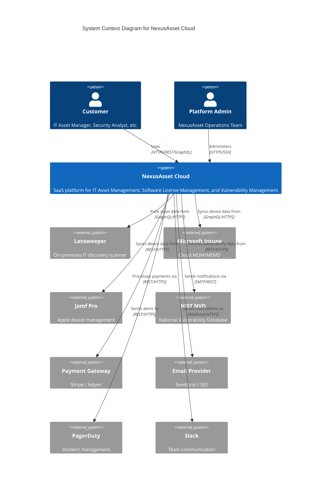

# DOC-18: Appendices

---

| **Document ID** | DOC-18 |
|-----------------|--------|
| **Title** | Appendices |
| **Version** | 1.0.0 |
| **Status** | ✓ Approved |
| **Owner** | Architecture & Documentation |
| **Last Updated** | 2026-11-09 |
| **Classification** | Internal — Confidential |
| **Related Docs** | All DOC-00 through DOC-18 |

---

## 1. Architecture Decision Records (ADR) Index

### 1.1 ADR Catalog

| ADR ID | Title | Status | Date | Authors | Related Docs |
|--------|-------|--------|------|---------|--------------|
| **ADR-001** | Monorepo Structure & Tooling | ✅ Accepted | 2025-01-15 | Platform Team | DOC-03, DOC-11 |
| **ADR-002** | Django + DRF for Backend | ✅ Accepted | 2025-01-15 | Backend Team | DOC-05, DOC-07 |
| **ADR-003** | Next.js 16 + React 19 for Frontend | ✅ Accepted | 2025-01-15 | Frontend Team | DOC-09 |
| **ADR-004** | Clean Architecture Layers | ✅ Accepted | 2025-01-20 | Architecture Team | DOC-05 |
| **ADR-005** | PostgreSQL 18 with RLS for Multi-tenancy | ✅ Accepted | 2025-01-20 | Data Team | DOC-04, DOC-06 |
| **ADR-006** | Redis 8 + Celery for Async Processing | ✅ Accepted | 2025-01-25 | Backend Team | DOC-05, DOC-06 |
| **ADR-007** | Traefik v3 as Ingress/Gateway | ✅ Accepted | 2025-01-25 | Platform Team | DOC-06, DOC-07 |
| **ADR-008** | Kubernetes (EKS) for Orchestration | ✅ Accepted | 2025-02-01 | Platform Team | DOC-06, DOC-11 |
| **ADR-009** | OpenTelemetry for Telemetry | ✅ Accepted | 2025-02-01 | Observability Team | DOC-13 |
| **ADR-010** | Prometheus + Thanos for Metrics | ✅ Accepted | 2025-02-05 | Observability Team | DOC-13 |
| **ADR-011** | Tempo for Distributed Tracing | ✅ Accepted | 2025-02-05 | Observability Team | DOC-13 |
| **ADR-012** | Loki for Log Aggregation | ✅ Accepted | 2025-02-05 | Observability Team | DOC-13 |
| **ADR-013** | Grafana for Visualization | ✅ Accepted | 2025-02-05 | Observability Team | DOC-13 |
| **ADR-014** | Cilium for CNI & Network Policy | ✅ Accepted | 2025-02-10 | Platform Team | DOC-06, DOC-12 |
| **ADR-015** | Vault for Secrets Management | ✅ Accepted | 2025-02-10 | Security Team | DOC-06, DOC-12 |
| **ADR-016** | GitOps with ArgoCD | ✅ Accepted | 2025-02-15 | Platform Team | DOC-11 |
| **ADR-017** | JWT + OIDC for Authentication | ✅ Accepted | 2025-02-15 | Security Team | DOC-07, DOC-12 |
| **ADR-018** | API Versioning Strategy | ✅ Accepted | 2025-02-20 | API Team | DOC-07 |
| **ADR-019** | Observability Stack Selection | ✅ Accepted | 2025-03-01 | Observability Team | DOC-13 |
| **ADR-020** | Sampling Strategy for Traces | ✅ Accepted | 2025-03-05 | Observability Team | DOC-13 |
| **ADR-021** | SLO Framework Definition | ✅ Accepted | 2025-03-10 | SRE Team | DOC-13 |
| **ADR-022** | Log Redaction & PII Handling | ✅ Accepted | 2025-03-10 | Security Team | DOC-13, DOC-16 |
| **ADR-023** | RUM Implementation Approach | ✅ Accepted | 2025-03-15 | Frontend Team | DOC-09, DOC-13 |
| **ADR-024** | Observability Cost Optimization | ✅ Accepted | 2025-03-20 | Platform Team | DOC-13 |
| **ADR-025** | Migration Strategy (Expand/Contract) | ✅ Accepted | 2025-04-01 | Data Team | DOC-14 |
| **ADR-026** | Tenant Isolation via RLS | ✅ Accepted | 2025-04-01 | Data Team | DOC-14, DOC-06 |
| **ADR-027** | Seed Data Management | ✅ Accepted | 2025-04-05 | Data Team | DOC-14 |
| **ADR-028** | Lansweeper Reconciliation Engine | ✅ Accepted | 2025-04-10 | Integration Team | DOC-08, DOC-14 |
| **ADR-029** | Rollback Procedures | ✅ Accepted | 2025-04-15 | Platform Team | DOC-14, DOC-15 |
| **ADR-030** | Disaster Recovery Strategy | ✅ Accepted | 2025-04-20 | SRE Team | DOC-15 |
| **ADR-031** | Incident Response Process | ✅ Accepted | 2025-05-01 | SRE Team | DOC-15 |
| **ADR-032** | On-Call Organization | ✅ Accepted | 2025-05-01 | SRE Team | DOC-15 |
| **ADR-033** | DR Strategy (Multi-region) | ✅ Accepted | 2025-05-05 | SRE Team | DOC-15 |
| **ADR-034** | Maintenance Windows | ✅ Accepted | 2025-05-10 | Platform Team | DOC-15 |
| **ADR-035** | Runbook Standards | ✅ Accepted | 2025-05-10 | SRE Team | DOC-15 |
| **ADR-036** | Security Operations | ✅ Accepted | 2025-05-15 | Security Team | DOC-12, DOC-15 |
| **ADR-037** | Compliance Framework Selection | ✅ Accepted | 2025-06-01 | Compliance Team | DOC-16 |
| **ADR-038** | Evidence Collection Automation | ✅ Accepted | 2025-06-05 | Compliance Team | DOC-16 |
| **ADR-039** | GDPR Implementation | ✅ Accepted | 2025-06-10 | Legal/Compliance | DOC-16 |
| **ADR-040** | Policy-as-Code (OPA) | ✅ Accepted | 2025-06-15 | Security Team | DOC-16 |
| **ADR-041** | Audit Readiness Procedures | ✅ Accepted | 2025-06-20 | Compliance Team | DOC-16 |
| **ADR-042** | Continuous Compliance Monitoring | ✅ Accepted | 2025-06-25 | Compliance Team | DOC-16 |

### 1.2 ADR Template

```markdown
# ADR-{NNN}: {Title}

**Status:** {Proposed | Accepted | Superseded | Rejected}
**Date:** {YYYY-MM-DD}
**Authors:** {Names}
**Reviewers:** {Names}

## Context
{Describe the problem, constraints, and forces at play.}

## Decision
{State the decision clearly and concisely.}

## Alternatives Considered
| Alternative | Pros | Cons | Reason for Rejection |
|-------------|------|------|---------------------|
| {Alt 1} | {Pros} | {Cons} | {Reason} |
| {Alt 2} | {Pros} | {Cons} | {Reason} |

## Consequences
### Positive
- {Benefit 1}
- {Benefit 2}

### Negative
- {Drawback 1}
- {Drawback 2}

### Risks
- {Risk 1}: {Mitigation}
- {Risk 2}: {Mitigation}

## Implementation Plan
1. {Step 1}
2. {Step 2}
3. {Step 3}

## References
- {Link to related docs, issues, external resources}

## Related ADRs
- ADR-{NNN}: {Title}
```

---

## 2. Traceability Matrices

### 2.1 Requirements → Capabilities → Use Cases → Test Cases

| REQ ID | Capability | Use Case | Test Case | Status |
|--------|------------|----------|-----------|--------|
| REQ-FN-001 | CAP-010 | UC-ASSET-001 | TC-INT-001 | ✅ Implemented |
| REQ-FN-002 | CAP-010 | UC-ASSET-002 | TC-INT-002 | ✅ Implemented |
| REQ-FN-003 | CAP-020 | UC-SYNC-001 | TC-E2E-001 | 🟡 In Progress |
| REQ-NFR-SEC-001 | CAP-030 | UC-AUTH-001 | TC-SEC-001 | ✅ Implemented |
| REQ-NFR-PRF-001 | CAP-040 | UC-API-001 | TC-PERF-001 | ✅ Implemented |
| REQ-NFR-AVL-001 | CAP-050 | UC-DR-001 | TC-DR-001 | ○ Planned |

### 2.2 Domain Model → Database Schema → API Endpoints

| Entity | Aggregate | Table | API Endpoint | CRUD |
|--------|-----------|-------|--------------|------|
| Asset | AGG-ASSET-001 | nxa_assets_asset | /api/v1/assets | CRUD |
| AssetCategory | AGG-ASSET-001 | nxa_assets_assetcategory | /api/v1/asset-categories | CRUD |
| Vulnerability | AGG-ASSET-002 | nxa_assets_vulnerability | /api/v1/vulnerabilities | R |
| SoftwareLicense | AGG-ASSET-003 | nxa_assets_softwarelicense | /api/v1/licenses | CRUD |
| SyncJob | AGG-LANS-001 | nxa_lansweeper_syncjob | /api/v1/sync/jobs | R |
| Tenant | AGG-TENT-001 | nxa_tenants_tenant | /api/v1/tenants | CRUD |
| Subscription | AGG-BILL-001 | nxa_billing_subscription | /api/v1/billing/subscriptions | CRUD |
| NotificationTemplate | AGG-NOTF-001 | nxa_notifications_template | /api/v1/notifications/templates | CRUD |
| AuditLog | AGG-AUDT-001 | nxa_audit_auditlog | /api/v1/audit/logs | R |

### 2.3 Bounded Context → Service → Deployment → Infrastructure

| Bounded Context | Django App | Service Name | K8s Deployment | Namespace | DB Schema |
|-----------------|------------|--------------|----------------|-----------|-----------|
| Core | nxa_core | nxa-core | nxa-core | nxa-prod | public + tenant_* |
| Accounts | nxa_accounts | nxa-accounts | nxa-accounts | nxa-prod | tenant_* |
| Tenants | nxa_tenants | nxa-tenants | nxa-tenants | nxa-prod | public |
| Assets | nxa_assets | nxa-assets | nxa-assets | nxa-prod | tenant_* |
| Lansweeper | nxa_lansweeper | nxa-lansweeper | nxa-lansweeper | nxa-prod | tenant_* |
| Billing | nxa_billing | nxa-billing | nxa-billing | nxa-prod | tenant_* |
| Notifications | nxa_notifications | nxa-notifications | nxa-notifications | nxa-prod | tenant_* |
| Audit | nxa_audit | nxa-audit | nxa-audit | nxa-prod | tenant_* |

### 2.4 Security Controls → Implementation → Evidence

| Control ID | Framework | Implementation | Evidence Location | Verification |
|------------|-----------|----------------|-------------------|--------------|
| CC6.1 | SOC 2 | RBAC/ABAC, MFA | `compliance/policies/k8s/rbac.rego` | OPA eval in CI |
| CC6.2 | SOC 2 | Vault, key rotation | `infrastructure/terraform/vault/` | Vault audit logs |
| CC6.3 | SOC 2 | Cilium NetworkPolicy | `infrastructure/kubernetes/network-policies/` | Cilium policy verify |
| CC6.7 | SOC 2 | Encryption at rest | `infrastructure/terraform/rds/` | AWS Config rule |
| A.9.1 | ISO 27001 | Access control policy | `docs/12-security-architecture.md` | Policy document |
| A.10.1 | ISO 27001 | Cryptographic controls | `infrastructure/terraform/kms/` | Key hierarchy doc |
| A.12.4 | ISO 27001 | Event logging | `observability/loki/` | Loki retention config |
| Art. 32 | GDPR | Security of processing | `docs/16-compliance-audit.md#7.3` | DPIA record |
| Art. 17 | GDPR | Right to erasure | `backend/nxa_core/compliance/gdpr.py` | Deletion workflow test |

---

## 3. Reference Architecture Diagrams

### 3.1 Diagram Inventory

| Diagram ID | Title | Type | Location | Description |
|------------|-------|------|----------|-------------|
| **DIA-C4-001** | C4 Level 1: System Context | Mermaid | `docs/architecture/diagrams/c4-context.mermaid` | External actors and systems |
| **DIA-C4-002** | C4 Level 2: Container Diagram | Mermaid | `docs/architecture/diagrams/c4-container.mermaid` | Applications and data stores |
| **DIA-C4-003** | C4 Level 3: Component - Assets | Mermaid | `docs/architecture/diagrams/c4-component-assets.mermaid` | Asset bounded context internals |
| **DIA-C4-004** | C4 Level 3: Component - Sync | Mermaid | `docs/architecture/diagrams/c4-component-sync.mermaid` | Lansweeper sync internals |
| **DIA-CLEAN-001** | Clean Architecture Layers | Mermaid | `docs/architecture/diagrams/clean-architecture.mermaid` | Domain, Application, Infrastructure |
| **DIA-DATA-001** | Logical Data Model (ERD) | Mermaid | `docs/architecture/diagrams/data-model.mermaid` | Core entities and relationships |
| **DIA-DATA-002** | Tenant Schema Isolation | Mermaid | `docs/architecture/diagrams/tenant-isolation.mermaid` | RLS and schema separation |
| **DIA-API-001** | API Gateway Flow | Mermaid | `docs/architecture/diagrams/api-gateway.mermaid` | Traefik → BFF → API → Services |
| **DIA-API-002** | BFF Aggregation Pattern | Mermaid | `docs/architecture/diagrams/bff-aggregation.mermaid` | GraphQL federation |
| **DIA-SYNC-001** | Lansweeper Sync Pipeline | Mermaid | `docs/architecture/diagrams/lansweeper-sync.mermaid` | Extract → Transform → Load → Reconcile |
| **DIA-SYNC-002** | Reconciliation Field Ownership | Mermaid | `docs/architecture/diagrams/field-ownership.mermaid` | Conflict resolution matrix |
| **DIA-INFRA-001** | Multi-Region Kubernetes | Mermaid | `docs/architecture/diagrams/multi-region-k8s.mermaid` | Primary/DR clusters |
| **DIA-INFRA-002** | Network Topology | Mermaid | `docs/architecture/diagrams/network-topology.mermaid` | VPC, subnets, endpoints |
| **DIA-INFRA-003** | Data Layer Architecture | Mermaid | `docs/architecture/diagrams/data-layer.mermaid` | PostgreSQL, Redis, Kafka, MinIO |
| **DIA-OBS-001** | Observability Stack | Mermaid | `docs/architecture/diagrams/observability-stack.mermaid` | OTEL → Prometheus/Tempo/Loki → Grafana |
| **DIA-OBS-002** | Distributed Trace Flow | Mermaid | `docs/architecture/diagrams/trace-flow.mermaid` | Client → Ingress → Services → Collector |
| **DIA-OBS-003** | Log Aggregation Pipeline | Mermaid | `docs/architecture/diagrams/log-pipeline.mermaid` | Filelog → OTEL → Loki |
| **DIA-SEC-001** | Zero Trust Architecture | Mermaid | `docs/architecture/diagrams/zero-trust.mermaid` | Identity, device, network, app, data |
| **DIA-SEC-002** | Encryption Hierarchy | Mermaid | `docs/architecture/diagrams/encryption-hierarchy.mermaid` | Keys, envelopes, data planes |
| **DIA-CICD-001** | CI/CD Pipeline | Mermaid | `docs/architecture/diagrams/cicd-pipeline.mermaid` | GitHub Actions → ArgoCD → K8s |
| **DIA-CICD-002** | Blue/Green Deployment | Mermaid | `docs/architecture/diagrams/blue-green.mermaid` | Traffic shifting |
| **DIA-DR-001** | Disaster Recovery Flow | Mermaid | `docs/architecture/diagrams/dr-flow.mermaid` | Region failover procedure |

### 3.2 Diagram Standards



---

## 4. Archived Source Documents

### 4.1 Archive Index

| Archive ID | Original File | Archive Date | Reason | Description |
|------------|---------------|--------------|--------|-------------|
| **SRC-001** | `requirements-analysis.md` | 2026-10-15 | Superseded by DOC-02, DOC-03 | Initial requirements gathering |
| **SRC-002** | `architecture-overview.md` | 2026-10-15 | Superseded by DOC-05, DOC-06 | High-level architecture draft |
| **SRC-003** | `api-spec-v1.yaml` | 2026-10-15 | Superseded by DOC-07 | OpenAPI 3.0 draft specification |
| **SRC-004** | `database-schema.sql` | 2026-10-15 | Superseded by DOC-04, DOC-14 | Initial schema DDL |
| **SRC-005** | `code-documentation.md` | 2026-10-15 | Superseded by DOC-05, DOC-09 | Inline code documentation guide |

### 4.2 Archive Storage

```
docs/14-appendices/
├── archived-source-01-requirements-analysis.txt
├── archived-source-02-architecture-overview.txt
├── archived-source-03-api-spec-v1.yaml
├── archived-source-04-database-schema.sql
└── archived-source-05-code-documentation.txt
```

> **Note:** Archived sources retained for historical reference and audit trail. Not authoritative for current implementation.

---

## 5. Fundamentals Distribution Map

### 5.1 33 Guides → Document Mapping

| Fundamental Guide | Primary Document | Secondary References |
|-------------------|------------------|---------------------|
| 01-RequirementsEngineering | DOC-03 | DOC-02 |
| 02-DomainDrivenDesign | DOC-04 | DOC-05 |
| 03-SoftwareArchitecturePatterns | DOC-05 | DOC-06 |
| 04-DatabaseDesign | DOC-04 | DOC-14 |
| 05-APIDesign | DOC-07 | DOC-05 |
| 06-FrontendArchitecture | DOC-09 | DOC-05 |
| 07-SecurityEngineering | DOC-12 | DOC-16 |
| 08-TestingStrategies | DOC-10 | DOC-05, DOC-09 |
| 09-DevOpsAndDeployment | DOC-11 | DOC-15 |
| 10-ObservabilityAndMonitoring | DOC-13 | DOC-15 |
| 11-PerformanceEngineering | DOC-05 | DOC-13, DOC-14 |
| 12-DataEngineering | DOC-14 | DOC-04, DOC-06 |
| 13-CloudArchitecture | DOC-06 | DOC-11, DOC-15 |
| 14-MicroservicesArchitecture | DOC-05 | DOC-08, DOC-09 |
| 15-EventDrivenArchitecture | DOC-05 | DOC-08, DOC-13 |
| 16-DomainModeling | DOC-04 | DOC-02 |
| 17-ArchitecturalDecisionRecords | DOC-18 | All |
| 18-TechnicalDocumentation | DOC-00 | All |
| 19-CodeQualityAndReviews | DOC-11 | DOC-05, DOC-09 |
| 20-SoftwareEstimation | DOC-11 | DOC-03 |
| 21-RiskManagement | DOC-02 | DOC-12, DOC-16 |
| 22-ChangeManagement | DOC-11 | DOC-14, DOC-15 |
| 23-ConfigurationManagement | DOC-06 | DOC-11, DOC-14 |
| 24-ReleaseManagement | DOC-11 | DOC-14, DOC-15 |
| 25-IncidentManagement | DOC-15 | DOC-13 |
| 26-ProblemManagement | DOC-15 | DOC-13, DOC-11 |
| 27-CapacityManagement | DOC-06 | DOC-13, DOC-15 |
| 28-ServiceLevelManagement | DOC-13 | DOC-15 |
| 29-ComplianceAndAudit | DOC-16 | DOC-12, DOC-14 |
| 30-VendorManagement | DOC-12 | DOC-16 |
| 31-BusinessContinuity | DOC-15 | DOC-06, DOC-30 |
| 32-OrganizationalArchitecture | DOC-01 | DOC-02 |
| 33-TechnicalLeadership | DOC-01 | All |

---

## 6. External References & Standards

### 6.1 Standards Bodies

| Standard | Version | Applicability | Reference |
|----------|---------|---------------|-----------|
| **ISO/IEC 27001** | 2022 | ISMS Certification | https://www.iso.org/standard/27001 |
| **ISO/IEC 27002** | 2022 | Control Implementation Guidance | https://www.iso.org/standard/27002 |
| **SOC 2** | 2017 | Trust Services Criteria | https://www.aicpa.org/soc |
| **NIST CSF** | 1.1 | Cybersecurity Framework | https://www.nist.gov/cyberframework |
| **NIST 800-53** | Rev 5 | Security Controls | https://csrc.nist.gov/publications/detail/sp/800-53/rev-5/final |
| **GDPR** | 2016/679 | EU Data Protection | https://eur-lex.europa.eu/eli/reg/2016/679 |
| **OWASP ASVS** | 4.0.3 | Application Security | https://owasp.org/www-project-application-security-verification-standard |
| **OWASP Top 10** | 2021 | Web App Security Risks | https://owasp.org/www-project-top-ten |
| **CIS Benchmarks** | Latest | Secure Configuration | https://www.cisecurity.org/cis-benchmarks |
| **PCI DSS** | 4.0 | Payment Card Security | https://www.pcisecuritystandards.org |
| **HIPAA** | 1996/2013 | Healthcare Privacy | https://www.hhs.gov/hipaa |
| **FedRAMP** | Rev 5 | Federal Cloud Authorization | https://www.fedramp.gov |

### 6.2 Technology References

| Technology | Version | Documentation | Repository |
|------------|---------|---------------|------------|
| **Django** | 5.2+ | https://docs.djangoproject.com | https://github.com/django/django |
| **Django REST Framework** | 3.15+ | https://www.django-rest-framework.org | https://github.com/encode/django-rest-framework |
| **Next.js** | 16+ | https://nextjs.org/docs | https://github.com/vercel/next.js |
| **React** | 19+ | https://react.dev | https://github.com/facebook/react |
| **PostgreSQL** | 18 | https://www.postgresql.org/docs | https://github.com/postgres/postgres |
| **Redis** | 8+ | https://redis.io/docs | https://github.com/redis/redis |
| **Kubernetes** | 1.29+ | https://kubernetes.io/docs | https://github.com/kubernetes/kubernetes |
| **Cilium** | 1.15+ | https://docs.cilium.io | https://github.com/cilium/cilium |
| **Prometheus** | 2.53+ | https://prometheus.io/docs | https://github.com/prometheus/prometheus |
| **Grafana** | 11.1+ | https://grafana.com/docs | https://github.com/grafana/grafana |
| **Tempo** | 2.4+ | https://grafana.com/docs/tempo | https://github.com/grafana/tempo |
| **Loki** | 2.9+ | https://grafana.com/docs/loki | https://github.com/grafana/loki |
| **OpenTelemetry** | 1.25+ | https://opentelemetry.io/docs | https://github.com/open-telemetry |
| **ArgoCD** | 2.10+ | https://argo-cd.readthedocs.io | https://github.com/argoproj/argo-cd |
| **Terraform** | 1.9+ | https://developer.hashicorp.com/terraform | https://github.com/hashicorp/terraform |
| **OPA** | 0.68+ | https://www.openpolicyagent.org/docs | https://github.com/open-policy-agent/opa |

---

## 7. Document Control & Governance

### 7.1 Document Lifecycle

| Phase | Activity | Owner | Approval |
|-------|----------|-------|----------|
| **Draft** | Author creates initial version | Document Owner | — |
| **Review** | Peer review by stakeholders | Document Owner + Reviewers | Reviewers sign-off |
| **Approved** | Architecture Review Board approval | Architecture Lead | ARB Chair |
| **Published** | Merged to main, versioned | Documentation Team | Auto (CI) |
| **Active** | Current version in use | All | — |
| **Superseded** | New version approved | Document Owner | ARB Chair |
| **Archived** | Moved to archive after 2 versions | Documentation Team | Auto (retention policy) |

### 7.2 Review Cadence

| Document Tier | Review Frequency | Trigger |
|---------------|------------------|---------|
| **Core Architecture** (DOC-00 to DOC-09) | Quarterly | Major release, ADR, incident |
| **Operational** (DOC-10 to DOC-15) | Semi-annually | Process change, audit finding |
| **Compliance** (DOC-16) | Annually | Regulation change, audit cycle |
| **Reference** (DOC-17, DOC-18) | As needed | Terminology change, new ADR |

### 7.3 Change Control

```yaml
# .github/workflows/doc-change-control.yml
name: Documentation Change Control

on:
  pull_request:
    paths:
      - 'docs/**/*.md'

jobs:
  validate:
    runs-on: ubuntu-latest
    steps:
      - uses: actions/checkout@v4
      
      - name: Check document metadata
        run: |
          python scripts/validate_doc_metadata.py docs/
      
      - name: Check cross-references
        run: |
          python scripts/validate_cross_references.py docs/
      
      - name: Check identifier consistency
        run: |
          python scripts/validate_identifiers.py docs/
      
      - name: Require ADR for architectural changes
        if: contains(github.event.pull_request.title, '[ARCH]')
        run: |
          python scripts/check_adr_linked.py ${{ github.event.pull_request.number }}
      
      - name: Auto-assign reviewers
        uses: actions/github-script@v7
        with:
          script: |
            // Assign based on document ownership
```

---

## 8. Glossary of Document-Specific Terms

| Term | Definition |
|------|------------|
| **Canonical** | Authoritative, standard, reference implementation |
| **Idempotent** | Operation producing same result regardless of repetitions |
| **Expand/Contract** | Schema migration pattern: add new, migrate, remove old |
| **Dual-Write** | Writing to both old and new systems during transition |
| **Golden Record** | Single authoritative record after reconciliation |
| **Field Ownership** | Explicit assignment of data authority per attribute |
| **Tenant Schema** | PostgreSQL namespace providing logical isolation |
| **RLS Policy** | Row-Level Security predicate enforcing tenant isolation |
| **Outbox Pattern** | Reliable messaging via database table + publisher |
| **BFF** | Backend for Frontend - client-specific API layer |
| **Module Federation** | Webpack feature for micro-frontend composition |
| **RSC** | React Server Components - server-rendered components |
| **SLO/SLI** | Service Level Objective/Indicator - reliability metrics |
| **Error Budget** | Inverse of SLO: allowed failure rate over time window |
| **Burn Rate** | Rate of error budget consumption |
| **Policy-as-Code** | Infrastructure/security policies expressed as code (Rego/OPA) |
| **GitOps** | Operations via Git: desired state in repo, automated sync |
| **Canary** | Gradual rollout to subset of users/traffic |
| **Blue/Green** | Two identical environments, instant traffic switch |
| **PITR** | Point-in-Time Recovery - restore to specific timestamp |
| **RPO/RTO** | Recovery Point/Time Objective - DR metrics |
| **DPIA** | Data Protection Impact Assessment (GDPR) |
| **ROPA** | Record of Processing Activities (GDPR Art. 30) |

---

> **Document Control:** This document is maintained by Architecture & Documentation. All appendices are living documents updated with each ADR and architecture change. Next review: 2027-02-09.