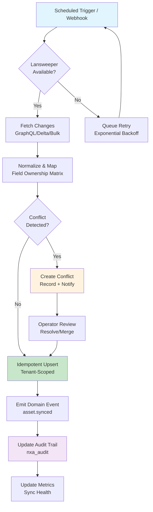
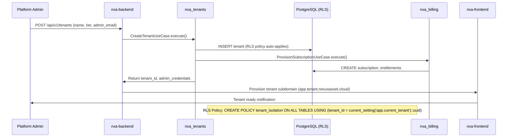

# ═══════════════════════════════════════════════════════════════
#  NEXUSASSET CLOUD — BUSINESS ANALYSIS
# ═══════════════════════════════════════════════════════════════
#  Document ID        : BA-001
#  Version            : 1.0.0
#  Status             : Baseline (Target/Design — Proposed Reference Architecture)
#  Classification     : Internal — Product & Architecture
#  Owner              : Product Management / Business Analysis
#  Last Reviewed      : 2026-11-09
#  Next Review        : 2026-12-09
#  Source Authority   : Project Charter, Stakeholder Workshops, Market Analysis
#  Related Docs       : EXEC-001, REQ-001, ARCH-001, DOM-001
# ═══════════════════════════════════════════════════════════════

# NexusAsset Cloud — Business Analysis
**Enterprise Capabilities, Processes, Use Cases, Governance & KPIs**

> **Purpose** — Define the business capabilities, core processes, use cases per bounded context, governance/compliance requirements, audit requirements, and key performance indicators for NexusAsset Cloud. This document bridges executive vision to technical requirements.

---

## Table of Contents
1. [Enterprise Capabilities Model](#1-enterprise-capabilities-model)
2. [Core Business Processes](#2-core-business-processes)
3. [Use Cases by Bounded Context](#3-use-cases-by-bounded-context)
4. [Governance & Compliance Requirements](#4-governance--compliance-requirements)
5. [Audit Requirements](#5-audit-requirements)
6. [Key Performance Indicators (KPIs)](#6-key-performance-indicators-kpis)
7. [Stakeholder Value Mapping](#7-stakeholder-value-mapping)
8. [Executive Summary](#8-executive-summary)

---

## 1. Enterprise Capabilities Model

NexusAsset Cloud delivers **8 core capability domains** organized around the asset lifecycle from discovery to governance:

┌─────────────────────────────────────────────────────────────────────┐
│ ▸ CAPABILITY MAP — NEXUSASSET CLOUD                                 │
├─────────────────────────────────────────────────────────────────────┤
│                                                                     │
│   ┌─────────────┐    ┌─────────────┐    ┌─────────────┐            │
│   │  DISCOVER   │───▶│  GOVERN     │───▶│  OPERATE    │            │
│   │             │    │             │    │             │            │
│   │ • Lansweeper│    │ • CMDB      │    │ • Monitoring│            │
│   │   Sync      │    │ • ITAM      │    │ • Alerting  │            │
│   │ • Webhooks  │    │ • Lifecycle │    │ • Backup/DR │            │
│   │ • Delta/Bulk│    │ • Relations │    │ • Capacity  │            │
│   └─────────────┘    └─────────────┘    └─────────────┘            │
│         │                  │                  │                     │
│         ▼                  ▼                  ▼                     │
│   ┌─────────────┐    ┌─────────────┐    ┌─────────────┐            │
│   │  SECURE     │    │  COMPLY     │    │  MONETIZE   │            │
│   │             │    │             │    │             │            │
│   │ • Tenant    │    │ • Audit     │    │ • Billing   │            │
│   │   Isolation │    │   Trail     │    │ • Subscriptions│         │
│   │ • RLS       │    │ • Evidence  │    │ • Entitlements│          │
│   │ • Encryption│    │ • Attestation│   │ • Usage     │            │
│   └─────────────┘    └─────────────┘    └─────────────┘            │
│                                                                     │
└─────────────────────────────────────────────────────────────────────┘

### 1.1 Capability Maturity Model (Target)

| Capability Domain | Level 1 (Initial) | Level 2 (Managed) | Level 3 (Defined) | Level 4 (Quantitative) | Level 5 (Optimizing) |
|---|---|---|---|---|---|
| **Discovery Sync** | Manual CSV import | Scheduled GraphQL sync | Delta + webhook + bulk | Idempotent, conflict-free | Predictive sync health |
| **CMDB/ITAM** | Asset list only | Relationships + lifecycle | Business-aligned taxonomy | Automated reconciliation | AI-assisted classification |
| **Multi-Tenancy** | Shared schema | Row-level security | Tenant-aware all layers | Zero-trust network | Autonomous tenant ops |
| **Governance** | Ad-hoc reviews | Policy definitions | Automated enforcement | Continuous compliance | Self-healing policies |
| **Billing** | Manual invoicing | Subscription mgmt | Usage-based metering | Revenue recognition | Predictive churn/upsell |
| **Observability** | Basic logs | Dashboards + alerts | Distributed tracing | SLO-based alerting | Predictive anomaly detection |

---

## 2. Core Business Processes

### 2.1 Process 1: Asset Discovery & Synchronization (Lansweeper → CMDB)



**Process Characteristics:**
- **Trigger**: Scheduled (hourly delta, daily full), Webhook (real-time), Manual (bulk)
- **Idempotency**: `source_id` + `source_system` + `tenant_id` unique constraint
- **Conflict Resolution**: Field Ownership Matrix (Lansweeper owns discovery fields; NexusAsset owns enrichment fields)
- **Audit**: Every sync attempt logged with correlation ID
- **SLA**: Delta sync < 5 min; Full sync < 30 min; Webhook processing < 30 sec

### 2.2 Process 2: Asset Lifecycle Management

| Stage | Activities | Responsible Context | Key Rules |
|---|---|---|---|
| **Discovered** | Auto-created from Lansweeper; read-only discovery fields | `nxa_lansweeper` → `nxa_assets` | Field Ownership: Lansweeper writes HW/SW specs |
| **Enriched** | Owner, location, cost center, tags, contracts added | `nxa_assets` (user-driven) | Field Ownership: NexusAsset writes enrichment |
| **Active** | In service; monitored; warranty tracked | `nxa_asset_lifecycle` | Relationships valid; dependencies mapped |
| **Maintenance** | Scheduled/unscheduled; change requests linked | `nxa_asset_lifecycle` + `nxa_integrations` | Change freeze windows enforced |
| **Decommissioned** | Data retained; relationships severed; audit preserved | `nxa_asset_lifecycle` | Legal hold check before purge |
| **Disposed** | Physical disposal certified; records archived | `nxa_asset_lifecycle` + `nxa_compliance` | Certificate of destruction stored |

### 2.3 Process 3: Tenant Onboarding & Provisioning



**Onboarding SLA**: < 15 minutes for standard tier; < 1 hour for enterprise (custom contracts).

### 2.4 Process 4: Compliance Audit & Evidence Generation

| Audit Trigger | Evidence Required | Generation Method | Retention |
|---|---|---|---|
| **SOC 2 Type II** | Access logs, change logs, encryption proof, incident records | Automated evidence pack (quarterly) | 7 years |
| **ISO 27001** | Risk treatment, SoA, internal audit, management review | On-demand + scheduled | 5 years |
| **GDPR** | DPIA, RoPA, DPA, breach log, DSAR log | Real-time + monthly export | 3 years post-relationship |
| **PCI DSS** (if billing) | Network diagrams, ASV scans, pen test, SAQ | Annual + on-change | 1 year |
| **Internal** | Asset changes, access grants, config drift | Continuous (nxa_audit) | Configurable (default 7 years) |

---

## 3. Use Cases by Bounded Context

### 3.1 nxa_accounts — Identity & Account Management

| UC-ID | Use Case | Actor | Precondition | Postcondition | Priority |
|---|---|---|---|---|---|
| UC-AC-001 | Register Account | Prospective User | Email not registered | Account created; verification email sent | High |
| UC-AC-002 | Authenticate (SSO/OIDC) | Registered User | Valid credentials | JWT + session cookie issued; tenant context resolved | Critical |
| UC-AC-003 | Manage Profile | Authenticated User | Active session | Profile updated; audit logged | Medium |
| UC-AC-004 | Password Reset | User (forgot password) | Email verified | Reset token issued; password updated | High |
| UC-AC-005 | Session Management | System | Active sessions | Expired sessions revoked; concurrent limit enforced | Medium |

### 3.2 nxa_identity — Authentication & Authorization Core

| UC-ID | Use Case | Actor | Precondition | Postcondition | Priority |
|---|---|---|---|---|---|
| UC-ID-001 | Issue Access Token | Auth Service | Valid auth grant | Short-lived JWT with tenant scope | Critical |
| UC-ID-002 | Validate Token | Any Service | Token presented | Claims verified; tenant_id extracted | Critical |
| UC-ID-003 | Manage Roles/Permissions | Tenant Admin | Tenant context | Role assignments updated; cache invalidated | High |
| UC-ID-004 | Impersonation (Support) | Platform Admin | Explicit consent + audit | Temporary token with audit trail | Medium |
| UC-ID-005 | Token Revocation | Auth Service | Security event / logout | Token blacklisted; sessions terminated | High |

### 3.3 nxa_tenants — Multi-Tenancy & Hierarchy

| UC-ID | Use Case | Actor | Precondition | Postcondition | Priority |
|---|---|---|---|---|---|
| UC-TN-001 | Create Tenant | Platform Admin | Valid tier, admin email | Tenant provisioned; RLS policies active; subdomain ready | Critical |
| UC-TN-002 | Manage Tenant Hierarchy | Tenant Admin | Parent tenant exists | Child tenant linked; inheritance rules applied | High |
| UC-TN-003 | Tenant Settings | Tenant Admin | Active tenant | Branding, features, limits updated | Medium |
| UC-TN-004 | Tenant Suspension/Deletion | Platform Admin | Contractual authority | Data archived; access revoked; billing stopped | High |
| UC-TN-005 | Cross-Tenant Reporting | Platform Admin | Super-admin role | Aggregated anonymized data only | Medium |

### 3.4 nxa_organizations — Organizational Structure

| UC-ID | Use Case | Actor | Precondition | Postcondition | Priority |
|---|---|---|---|---|---|
| UC-OR-001 | Create Organization | Tenant Admin | Tenant context | Org unit created; hierarchy maintained | High |
| UC-OR-002 | Assign Users to Org | Org Admin | Users exist in tenant | Membership created; permissions inherited | High |
| UC-OR-003 | Cost Center Mapping | Finance Admin | Org units defined | Assets linked to cost centers | Medium |
| UC-OR-004 | Org-Based Access Control | System | Org membership | Resource access filtered by org | High |

### 3.5 nxa_assets — CMDB & Asset Management

| UC-ID | Use Case | Actor | Precondition | Postcondition | Priority |
|---|---|---|---|---|---|
| UC-AS-001 | View Asset Inventory | Asset Manager | Tenant context | Paginated, filtered asset list returned | Critical |
| UC-AS-002 | Asset Detail & Relationships | Asset Manager | Asset exists | Full asset graph (dependencies, dependents) | Critical |
| UC-AS-003 | Bulk Asset Operations | Asset Manager | Selection made | Mass update/tag/move executed idempotently | High |
| UC-AS-004 | Asset Search & Filter | Any User | Tenant context | Full-text + faceted search results | High |
| UC-AS-005 | Custom Fields & Tags | Tenant Admin | Schema extension | User-defined fields searchable | Medium |
| UC-AS-006 | Asset Import/Export | Asset Manager | Template provided | CSV/Excel round-trip with validation | Medium |

### 3.6 nxa_asset_lifecycle — Advanced Lifecycle & Ownership

| UC-ID | Use Case | Actor | Precondition | Postcondition | Priority |
|---|---|---|---|---|---|
| UC-AL-001 | Warranty & Contract Tracking | Asset Owner | Asset active | Expiry alerts; renewal workflows | High |
| UC-AL-002 | Change Management Integration | Change Manager | Change request | Asset CI linked; impact analyzed | High |
| UC-AL-003 | Depreciation & Financial Lifecycle | Finance | Asset capitalized | Depreciation schedule; disposal trigger | Medium |
| UC-AL-004 | License Compliance | SAM Manager | Software assets | Installs vs entitlements reconciled | High |
| UC-AL-005 | Asset Disposal Workflow | Asset Owner | Decommission approved | Disposal certified; audit complete | Medium |

### 3.7 nxa_lansweeper — Discovery Integration (CRITICAL)

| UC-ID | Use Case | Actor | Precondition | Postcondition | Priority |
|---|---|---|---|---|---|
| UC-LS-001 | Configure Lansweeper Connection | Tenant Admin | Credentials provided | GraphQL endpoint validated; webhook registered | Critical |
| UC-LS-002 | Full Sync Execution | Scheduler / Admin | Connection configured | All assets synced; cursor updated | Critical |
| UC-LS-003 | Delta Sync Execution | Scheduler (hourly) | Cursor exists | Changes since cursor synced | Critical |
| UC-LS-004 | Bulk Import | Admin | CSV/JSON file | Batch processed; conflicts queued | High |
| UC-LS-005 | Webhook Processing | Lansweeper Platform | Event fired | Single asset change processed <30s | Critical |
| UC-LS-006 | Conflict Resolution | Asset Manager | Conflict detected | Owner decision applied; audit logged | High |
| UC-LS-007 | Sync Health Monitoring | Operator | Sync history | Dashboard: success rate, latency, conflicts | High |
| UC-LS-008 | Field Ownership Policy Management | Tenant Admin | Integration active | Matrix updated; future syncs respect policy | Medium |

### 3.8 nxa_integrations — Generic Integration Framework

| UC-ID | Use Case | Actor | Precondition | Postcondition | Priority |
|---|---|---|---|---|---|
| UC-IN-001 | Register External System | Tenant Admin | API credentials | System registered; health check configured | Medium |
| UC-IN-002 | Define Sync Mapping | Integration Engineer | Source/target schemas | Transformation rules deployed | Medium |
| UC-IN-003 | Execute Integration Job | Scheduler / Event | Mapping active | Data transformed; errors quarantined | Medium |
| UC-IN-004 | Integration Health Dashboard | Operator | Integrations running | Real-time status, latency, error rates | Medium |

### 3.9 nxa_billing — Financial Transactions & Invoicing

| UC-ID | Use Case | Actor | Precondition | Postcondition | Priority |
|---|---|---|---|---|---|
| UC-BL-001 | Create Subscription | Tenant Admin / Sales | Plan selected | Subscription active; entitlements provisioned | Critical |
| UC-BL-002 | Process Recurring Billing | Scheduler (monthly) | Active subscriptions | Invoices generated; payments attempted | Critical |
| UC-BL-003 | Handle Payment Events | Payment Gateway | Webhook received | Invoice status updated; dunning triggered | Critical |
| UC-BL-004 | Usage Metering | System | Metered features | Usage aggregated; overage calculated | High |
| UC-BL-005 | Credit Notes & Refunds | Finance Admin | Invoice exists | Credit issued; revenue adjusted | Medium |

### 3.10 nxa_subscriptions — Plans & Entitlements

| UC-ID | Use Case | Actor | Precondition | Postcondition | Priority |
|---|---|---|---|---|---|
| UC-SU-001 | Define Plan Catalog | Product Admin | Pricing approved | Plans versioned; features gated | High |
| UC-SU-002 | Entitlement Enforcement | Any Service | Feature accessed | Access granted/denied per plan | Critical |
| UC-SU-003 | Plan Upgrade/Downgrade | Tenant Admin | Active subscription | Proration calculated; entitlements updated | High |
| UC-SU-004 | Trial Management | Prospect | Trial started | Auto-convert or expire; limits enforced | Medium |

### 3.11 nxa_notifications — Multi-Channel Delivery

| UC-ID | Use Case | Actor | Precondition | Postcondition | Priority |
|---|---|---|---|---|---|
| UC-NT-001 | Send Notification | Any Service | Event triggered | Notification queued; delivery attempted | High |
| UC-NT-002 | Manage Preferences | User | Account exists | Channel/opt-out preferences respected | High |
| UC-NT-003 | Template Management | Tenant Admin | Branding approved | Templates versioned; preview available | Medium |
| UC-NT-004 | Delivery Tracking | Operator | Notification sent | Status: sent/delivered/failed/read | Medium |

### 3.12 nxa_audit — Immutable Audit Trail

| UC-ID | Use Case | Actor | Precondition | Postcondition | Priority |
|---|---|---|---|---|---|
| UC-AU-001 | Record Audit Event | Any Service | State change | Append-only event stored; immutable | Critical |
| UC-AU-002 | Query Audit Trail | Auditor | Permissions granted | Filtered, paginated results exported | Critical |
| UC-AU-003 | Generate Evidence Pack | Compliance | Audit period | Signed, timestamped evidence bundle | High |
| UC-AU-004 | Retention & Archival | Scheduler | Policy defined | Cold storage; legal hold respected | Medium |

### 3.13 nxa_reporting — Analytics & Exports

| UC-ID | Use Case | Actor | Precondition | Postcondition | Priority |
|---|---|---|---|---|---|
| UC-RP-001 | Dashboard Widgets | Any User | Permissions | Real-time charts; drill-down | High |
| UC-RP-002 | Scheduled Reports | Report Admin | Template defined | PDF/CSV/Excel delivered via email/storage | Medium |
| UC-RP-003 | Ad-hoc Query Builder | Analyst | Data access | Safe SQL execution; export | Medium |
| UC-RP-004 | BI Integration | Data Engineer | Schema published | Star schema views; incremental refresh | Low |

### 3.14 nxa_compliance — Policy & Attestation

| UC-ID | Use Case | Actor | Precondition | Postcondition | Priority |
|---|---|---|---|---|---|
| UC-CP-001 | Define Policy Rules | Compliance Admin | Framework selected | Rules codified; automated checks | High |
| UC-CP-002 | Run Compliance Scan | Scheduler / Manual | Policies active | Violations detected; remediation tasks | High |
| UC-CP-003 | Attestation Workflow | Control Owner | Period open | Evidence collected; sign-off recorded | High |
| UC-CP-004 | Exception Management | Risk Owner | Violation found | Exception documented; expiry tracked | Medium |

### 3.15 nxa_core — Shared Kernel & Cross-Cutting

| UC-ID | Use Case | Actor | Precondition | Postcondition | Priority |
|---|---|---|---|---|---|
| UC-CR-001 | Health & Readiness Checks | Orchestrator | Service running | HTTP 200/503 with dependency status | Critical |
| UC-CR-002 | Configuration Management | Platform Admin | Config changed | Hot-reload where safe; validation | High |
| UC-CR-003 | Feature Flags | Product | Flag defined | Gradual rollout; kill switch | Medium |
| UC-CR-004 | Correlation ID Propagation | All Services | Request received | Trace ID logged end-to-end | Critical |

---

## 4. Governance & Compliance Requirements

### 4.1 Data Governance Framework

| Domain | Requirement | Implementation | Verification |
|---|---|---|---|
| **Data Classification** | All data classified: Public, Internal, Confidential, Restricted | `nxa_compliance` policy engine + column tags | Automated scan quarterly |
| **Data Lineage** | Discovery → CMDB → Reports traceable | `nxa_audit` + `source_id` propagation | Lineage graph in `nxa_reporting` |
| **Data Quality** | Completeness, accuracy, timeliness thresholds | Sync health metrics + validation rules | SLA: >99% completeness |
| **Data Retention** | Per-class retention + legal hold | `nxa_audit` retention jobs + hold flags | Annual compliance review |
| **Data Privacy** | GDPR Art. 25 (by design), Art. 32 (security) | Pseudonymization, encryption, DPIA | DPIA updated per major release |

### 4.2 Regulatory Compliance Matrix

| Regulation | Scope | Key Controls | Evidence Artifacts |
|---|---|---|---|
| **SOC 2 Type II** | Security, Availability, Confidentiality | Access control, encryption, monitoring, incident response | Audit report, control matrix, pen test |
| **ISO 27001** | ISMS | Risk treatment, SoA, internal audit, management review | Certification, SoA, risk register |
| **GDPR** | Personal data processing | DPIA, RoPA, DPA, breach notification (72h), DSAR (30d) | DPIA, RoPA, breach log, DSAR log |
| **PCI DSS** (billing) | Cardholder data | Network segmentation, ASV scans, pen test, SAQ/RoC | ASV report, pen test, SAQ/RoC |
| **NIST CSF** | Cybersecurity framework | Identify, Protect, Detect, Respond, Recover | Maturity assessment, action plan |

### 4.3 Policy Enforcement Points

| Policy | Enforcement Layer | Tool/Mechanism |
|---|---|---|
| **Tenant Isolation** | Database (RLS) + Application (middleware) | PostgreSQL RLS + `tenant_context` middleware + negative tests |
| **Least Privilege** | RBAC + ABAC | `nxa_identity` permissions + `nxa_organizations` hierarchy |
| **Secret Management** | Infrastructure + Runtime | SOPS + Vault; no secrets in images/Git |
| **Supply Chain** | Build + Deploy | SLSA Level 3; Cosign signing; SBOM (Syft); Trivy scanning |
| **Vulnerability Management** | CI/CD + Runtime | Trivy (container), Gitleaks (secrets), SonarQube (code), Dependabot (deps) |

---

## 5. Audit Requirements

### 5.1 Audit Event Taxonomy

| Category | Event Types | Retention | Immutable |
|---|---|---|---|
| **Authentication** | login, logout, mfa, token_issue, token_revoke | 7 years | Yes |
| **Authorization** | role_assign, permission_change, impersonation | 7 years | Yes |
| **Asset Management** | create, update, delete, bulk_op, relationship_change | 7 years | Yes |
| **Discovery Sync** | sync_start, sync_complete, conflict, webhook_process | 7 years | Yes |
| **Billing** | subscription_create, invoice_generate, payment, refund | 10 years (financial) | Yes |
| **Configuration** | feature_flag, secret_rotation, schema_migration | 5 years | Yes |
| **Security** | vuln_detected, scan_complete, incident, access_denied | 7 years | Yes |
| **Administrative** | tenant_create, tenant_delete, user_provision, backup | 7 years | Yes |

### 5.2 Audit Event Structure (Standard)

```json
{
  "event_id": "uuid-v7",
  "event_type": "asset.updated",
  "event_version": "1.0",
  "timestamp": "2026-11-09T10:30:00Z",
  "correlation_id": "uuid-v7",
  "actor": {
    "type": "user|system|integration",
    "id": "user-uuid|service-name|lansweeper",
    "tenant_id": "tenant-uuid",
    "roles": ["asset_manager"],
    "ip": "192.0.2.1"
  },
  "resource": {
    "type": "asset",
    "id": "asset-uuid",
    "tenant_id": "tenant-uuid"
  },
  "action": "update",
  "outcome": "success|failure|partial",
  "changes": {
    "before": {"location": "DC-1", "owner": "john"},
    "after": {"location": "DC-2", "owner": "jane"}
  },
  "metadata": {
    "source": "web|api|sync|webhook",
    "request_id": "req-uuid",
    "user_agent": "Mozilla/5.0...",
    "risk_level": "low|medium|high|critical"
  }
}
```

### 5.3 Audit Query & Export Requirements

| Requirement | Specification |
|---|---|
| **Query Performance** | P95 < 2s for 1M events (indexed by tenant_id, timestamp, event_type) |
| **Export Formats** | JSON Lines (streaming), CSV, Parquet (analytics), PDF (evidence packs) |
| **Time Range** | Arbitrary range; relative (last 24h, 30d, custom) |
| **Filters** | tenant_id, event_type, actor_id, resource_id, outcome, risk_level |
| **Integrity** | SHA-256 hash chain per tenant; Merkle root published periodically |
| **Legal Hold** | Hold flag prevents deletion/archival; overrides retention policy |

---

## 6. Key Performance Indicators (KPIs)

### 6.1 Platform Health KPIs

| KPI | Target | Measurement | Frequency | Owner |
|---|---|---|---|---|
| **Availability (Platform)** | 99.9% | Uptime / (Uptime + Downtime) | Real-time | SRE |
| **API Latency (P95)** | < 500ms | `http_request_duration_seconds` | Real-time | Backend |
| **API Error Rate** | < 0.1% | 5xx / total requests | Real-time | Backend |
| **Sync Success Rate** | > 99.5% | Successful syncs / total attempts | Per sync | Integration |
| **Sync Latency (Delta)** | < 5 min | Webhook to DB commit | Per sync | Integration |
| **Tenant Provisioning Time** | < 15 min | API call to subdomain ready | Per event | Platform |

### 6.2 Business Value KPIs

| KPI | Target | Measurement | Frequency | Owner |
|---|---|---|---|---|
| **Asset Data Accuracy** | > 95% | Sample audit vs source of truth | Quarterly | Product |
| **Tenant Activation Rate** | > 80% day-1 | Activated tenants / provisioned | Daily | Product |
| **Monthly Recurring Revenue** | Growth > 20% YoY | Billing system | Monthly | Finance |
| **Net Revenue Retention** | > 110% | Expansion - churn / starting MRR | Quarterly | Finance |
| **Customer Satisfaction (CSAT)** | > 4.5/5 | In-app survey | Continuous | Product |
| **Support Ticket Volume** | < 50/month per 100 tenants | Helpdesk | Monthly | Support |

### 6.3 Security & Compliance KPIs

| KPI | Target | Measurement | Frequency | Owner |
|---|---|---|---|---|
| **Critical Vulnerability SLA** | < 24h patch | CVE publish to deploy | Per CVE | Security |
| **Cross-Tenant Access Attempts** | 0 successful | Negative test results + WAF logs | Continuous | Security |
| **Audit Trail Completeness** | 100% | Required events / logged events | Daily | Compliance |
| **Secret Detection** | 0 in Git/Images | Gitleaks + Trivy scans | Per commit | Security |
| **Compliance Evidence Freshness** | < 30 days | Last evidence pack generation | Monthly | Compliance |

### 6.4 Operational Excellence KPIs

| KPI | Target | Measurement | Frequency | Owner |
|---|---|---|---|---|
| **Deployment Frequency** | > 1/day (main) | Jenkins + GitHub Actions | Daily | DevOps |
| **Lead Time (Commit → Prod)** | < 2 hours | Pipeline duration | Per deploy | DevOps |
| **Change Failure Rate** | < 5% | Failed deployments / total | Weekly | DevOps |
| **MTTR (Mean Time to Recovery)** | < 30 min | Incident open to resolved | Per incident | SRE |
| **Backup Restore Test** | Monthly success | Restore drill completion | Monthly | SRE |
| **Documentation Coverage** | > 95% | Documented APIs / total APIs | Per release | Tech Writers |

---

## 7. Stakeholder Value Mapping

| Stakeholder | Primary Value | Measured By | Platform Capabilities |
|---|---|---|---|
| **CIO / CTO** | Strategic asset visibility, risk reduction | Asset coverage %, audit readiness | CMDB, Compliance, Reporting |
| **IT Asset Manager** | Operational efficiency, data accuracy | Sync success rate, manual corrections | Lansweeper Sync, Asset Lifecycle |
| **Security Officer** | Zero-trust posture, incident response | Cross-tenant incidents, MTTR | Tenant Isolation, Audit, Monitoring |
| **Finance Director** | Revenue optimization, billing accuracy | MRR growth, billing disputes | Billing, Subscriptions, Metering |
| **Compliance Lead** | Regulatory adherence, evidence automation | Audit findings, evidence freshness | Audit Trail, Compliance Engine |
| **DevOps Lead** | Platform reliability, deployment velocity | DORA metrics, availability | IaC, CI/CD, Observability |
| **End User (Tenant)** | Self-service, actionable insights | CSAT, time-to-insight | Frontend, Mobile, Dashboards |
| **Auditor** | Complete, tamper-proof evidence | Audit duration, evidence gaps | Audit Export, Integrity Verification |

---

## 8. Executive Summary

> **NexusAsset Cloud** addresses the **enterprise IT asset management gap** by unifying **Lansweeper discovery** with **governance-grade CMDB, multi-tenancy, billing, audit, and compliance** in a single platform.
>
> **Business Capabilities**: 8 domains (Discover, Govern, Operate, Secure, Comply, Monetize, Integrate, Analyze) across 15 bounded contexts. Core processes: Discovery Sync (idempotent, conflict-aware), Asset Lifecycle (6 stages), Tenant Onboarding (<15 min), Compliance Audit (automated evidence packs).
>
> **Use Cases**: 60+ detailed use cases across all contexts, prioritized Critical/High/Medium. **Lansweeper integration** (8 use cases) is the critical differentiator — supports GraphQL, webhooks, delta, bulk, with Field Ownership Matrix governing write authority.
>
> **Governance**: Built for SOC 2, ISO 27001, GDPR, PCI DSS. Audit trail immutable (SHA-256 chained), 7-10 year retention, legal hold support. Policy enforcement at database (RLS), application (middleware), and infrastructure (IaC) layers.
>
> **KPIs**: 20+ quantified targets across Platform Health, Business Value, Security/Compliance, Operational Excellence. DORA metrics for DevOps; DPIA/RoPA for privacy; SLAs for sync/availability.
>
> **Risk**: Medium-High (RLS at scale, Lansweeper API dependency, Clean Architecture discipline). Mitigated by phased verification, contract tests, chaos engineering, architecture governance.
>
> **Next Step**: Validate use cases with stakeholders → Finalize Requirements Specification (REQ-001) → Begin Phase 1 implementation via `prompts/01-foundation-and-tooling.md`.

---

**End of file — NexusAsset Cloud / docs@nexusasset.cloud**